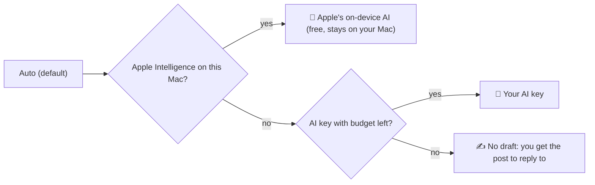

# AI credits, costs and profit

Two cards on the Today page answer "what does running this business cost, and what's really left?" Both appear once
you're connected (not in the sample data). Everything is read-only: keys stay in your Keychain and nothing is sent
anywhere except the service each key belongs to.

## Use any AI model, or none

**Everything in Hmunmawi works without AI.** AI only adds wording on top: you pick the provider and the model, use
your own key, and set how much it may spend.

- **Providers:** Claude (Anthropic), OpenAI, Google Gemini, OpenRouter, Groq, Mistral, Ollama (free, runs on your
  Mac) or any other OpenAI-compatible service. Settings → General → AI wording: provider, model and key (the key
  stays in your Keychain).
- **What AI writes for you:** reply drafts for reviews, featuring nomination pitches, outreach follow-ups, Rejection
  Shield texts and review notes, the "Predict" read on where the month lands, a polish of your weekly story, the
  wording of your next steps, and AI briefs and post drafts in routines. Every result is shown to you first; nothing
  is sent or changed without your OK.
- **A monthly limit:** set the most Hmunmawi may spend on AI each month (estimated from the tokens your provider
  reports). For a provider whose prices it doesn't know, you enter the price per million tokens. A routine's AI brief
  can have its own monthly cap.
- **Keep it separate at your provider:** the app tells you how, for your provider (for example, a separate workspace
  with its own spend limit in the Claude Console, or a dedicated key with a limit elsewhere), so Hmunmawi's spending
  is capped there too.
- **Apple's on-device model:** free, private, no key. See [Apple's on-device AI](#apples-on-device-ai) below.

The credit tracking below is about what you pay providers, whatever you use. API credits (grants and monthly credits)
are tracked for Anthropic because its console gives credits that way; OpenAI, xAI, OpenRouter and DeepSeek spend is read
with read-only keys; anything else (Gemini, a subscription) goes in Tools and plans.

## Payday & profit

- **Apple's next payment:** the amount from Apple's monthly finance report, converted at today's rate. Apple's API
  doesn't give the payment date, so it comes from Apple's payment calendar (about 33 days after Apple's fiscal month
  ends) and is shown as an estimate.
- **This month:** a forecast from Apple's daily sales so far.
- **Costs paid so far:** your tools and plans plus what your AI accounts spent.
- **Profit:** what's left after costs, in the currency you chose.

### Tools and plans

Add what you pay to run the business: tools, memberships, AI plans. Monthly or yearly, in any currency.

- **Free plans** (a startup program, a promotion) are listed but never counted as a cost.
- **Cancelled plans:** give it an end date; it's listed but not counted after that.
- Google's Gemini API has no simple way to read spend, so add it here by hand.

## AI & subscriptions

How much of each plan's limit you've used and when it resets, plus your API credits. Sources are tried in order and
the card says which one each figure came from:

1. **Official APIs**, when you add a read-only key:
   - **Anthropic:** an Admin key (console.anthropic.com → Settings → Admin keys) lets Hmunmawi read what your Claude
     API keys spent, from Anthropic's cost report. At most one read every 30 minutes.
   - **OpenAI and xAI** (what each account spent) and **OpenRouter and DeepSeek** (what each has left), at most once
     every 30 minutes per account.
2. **A usage file your own bot writes** (see below).
3. **Other apps' local files:** Grok Bot's weekly usage, only when you named Grok Bot as your bot in Settings; and
   per-account Claude usage files written by a tool of yours, only after you set their folder. These formats aren't
   official, so a change in them shows as "couldn't read", never as a wrong number.
4. **Typed by you:** plan, price and renewal date, from Tools and plans.

You can switch any source off. A ready-made rule can alert you when a plan passes 80% (Settings → Rules → AI &
subscriptions).

### API credits

Anthropic has no API for credit balances, so you type each credit once: the amount, when it started and, for a
monthly credit, when the next one arrives. What's been used is then read live from Anthropic's cost report (with an
Admin key), or taken from what you typed.

- **Free credits** (a startup program, a monthly team credit) and credits you top up with your own money are kept
  apart, so the card can say, for example, "startup credit used up · monthly credit $12 of $40 left".

### Usage file format

Any script or bot can report a plan's usage by writing a JSON file to
`~/Library/Application Support/Hmunmawi/usage/` (any name ending in `.json`):

```json
{
  "services": [
    { "name": "Example AI", "plan": "Pro", "used_percent": 42, "resets": "2026-12-01T00:00:00Z", "updated": "2026-11-14T09:00:00Z" }
  ]
}
```

- `name` (required) and `plan`: up to 60 characters each.
- `used_percent`: 0 to 100.
- `resets` and `updated`: ISO 8601 dates.

### AI job pause

If your own scripts run AI jobs (an overnight batch, a research job), the AI job pause lets you stop them until a
time, or until you say so. Set the first pause with `hm ai-pause-set`; from then on the AI job pause card shows under
AI & subscriptions, where you can change or clear it, and the menu bar shows when it's on.
Your scripts ask `hm ai-pause-check` before starting (it answers "available" or "deferred"). Hmunmawi itself never starts a paid AI call without a key you added.

## Apple's on-device AI

> [!TIP]
> **Free, private, no key.** On a Mac with Apple Intelligence (macOS 26 or later), Hmunmawi uses Apple's own
> language model, which runs on the Mac. Nothing it reads leaves your computer, and it costs nothing.

**When Hmunmawi uses it**

| Where | What it does | When it runs | What you see |
|---|---|---|---|
| 💬 **X reply ideas** (via Safari) | Drafts one short reply for each post found | First reply time each day, with *Drafts by: Auto* (default) or *Apple's on-device AI* | A ready draft in your message, to edit and post yourself |
| 📬 **Outreach replies** | Reads a mail reply the rules can't place: a question, a promise, a no | When a reply arrives that the rules leave unclear | A "maybe", with the words that show it, for you to confirm |

**Who drafts X replies (Drafts by)**

With *Auto* (the default), Hmunmawi tries these in order and uses the first that works:

1. 🧠 **Apple's on-device AI**, if Apple Intelligence is on for this Mac. Free, and nothing leaves your Mac.
2. 🔑 **Your AI key**, if you added one and its budget isn't used up.
3. ✍️ **No draft:** you get the post to reply to and write it yourself.

The same flow as a diagram (shown as plain text in some viewers; the list above says the same):



Pick *Apple's on-device AI*, *My AI key* or *No drafts* to use only that; a fixed choice never falls back to another.

**When it isn't available, Hmunmawi says why, in plain words**

| Situation | Message in the app | What happens |
|---|---|---|
| Mac doesn't support Apple Intelligence | "This Mac doesn't support Apple Intelligence." | Auto uses your AI key, or no drafts |
| Apple Intelligence is off | "Turn on Apple Intelligence in System Settings." | Same |
| Model still downloading | "Apple Intelligence is still getting ready (downloading)." | Same, until it's ready |

**Safeguards**

- Drafts never invent numbers, results or facts about you; the prompt forbids it, and every draft reaches you before
  anything is posted (you always post yourself).
- Drafts with links, hashtags, over 280 characters, or where the model has nothing real to add are dropped.
- When Apple's safety check declines a request, that post is skipped, never worked around, as Apple's
  [acceptable use requirements](https://developer.apple.com/apple-intelligence/acceptable-use-requirements-for-the-foundation-models-framework/) ask.

Full rules: [X-TECHNICAL.md → Reply ideas](X-TECHNICAL.md#reply-ideas-does-reply-ideas).

