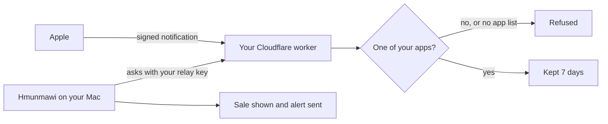
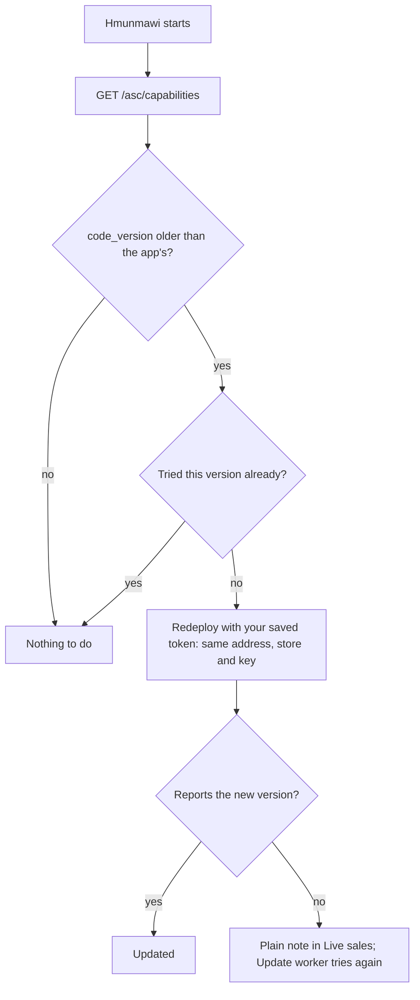

# ASC webhook event relay (protocol v2)

> **Who needs this:** only developers working on Hmunmawi's live-sales worker (the small Cloudflare worker you can
> deploy to your own account from Settings → Connections → Live sales). Users don't need to read it: the app sets
> the worker up for you.

## How live sales reach your Mac, in plain words

1. You switch on *within seconds* in Settings → Connections; Hmunmawi deploys a small worker to **your own**
   Cloudflare account and shows its address.
2. You paste that address into App Store Connect once.
3. When someone buys or renews, Apple sends a signed notification to your worker. It keeps only Apple-signed ones,
   for 7 days.
4. Your Mac collects them from the worker with a private relay key (about once a minute today), and Hmunmawi shows the
   sale and alerts you by your rules.

The live-sales worker only takes notifications for the bundle ids in your app names (Settings → Connections → Live
sales); without that list it takes nothing (HTTP 503) and Hmunmawi asks for the names before it deploys. Bodies over
64 KB are refused. The webhook-only worker (`hmunmawi-hooks`) receives App Store Connect webhooks on `/asc` and has
no app list; its `/asc` paths are unaffected.

## Keeping the worker up to date

Each worker reports its code version at `GET /asc/capabilities` (`code_version`; workers from before 1.5.2 don't, which
counts as 0). When Hmunmawi starts and the webhook worker is older than the code the app carries, it redeploys it once
with the Cloudflare token you saved, keeping its address, store and relay key, then checks the new version. A failed
update is not retried by itself (one try per code version); it says so in Live sales, and the worker keeps running as
before. **Update worker** (next to Remove, for the webhook worker and for a purchase worker you deployed from the app)
does the same on demand.

For developers: whenever any file in `Resources/LiveWorker/` changes, bump `WORKER_CODE_VERSION` in `workerCore.mjs`,
`LivePurchases.workerCodeVersion` and `Resources/LiveWorkerVersion.json` (its `sha256` covers every worker file);
`WorkerVersionTests` fails until all three match.

The rest of this page is the technical design for developers.

## Problem

Legacy `GET /asc/outbox` lists every `wh:` key in Workers KV on each poll (up to 500 keys per page) before filtering by `since`. On the Workers Free plan, KV **list** reads are tightly capped (~1,000/day per namespace). A Mac client polling once per minute burns through that budget and can drop events when more than 200 share the same millisecond bucket.

## Design

| Piece | Role |
| ----- | ---- |
| `AscRelayDO` | SQLite-backed ordered log (`seq`), per-consumer ACK, hibernatable WebSocket push |
| `POST /asc` | Unchanged HMAC verification; persists to the DO **before** `200 OK`; optional `ASC_KV_MIRROR` for one-release cutover only |
| `GET /asc/events` | Paged catchup by `after_seq` (no KV `list`) |
| `GET /asc/stream` | WebSocket with `Authorization: Bearer <RELAY_KEY>`; app-level `ping`/`pong` auto-reply does not wake the DO |
| `GET /asc/outbox` | Legacy pull path kept for rollback; disabled on the Mac when `HMUseAscEventStream` is on |

Consumer isolation uses `consumer` (query param, default `mac-default`) and relay-key auth at the Worker edge.

## Activation (not done in this change)

1. Wait until KV list quota has reset and you are ready to cut over (do **not** run KV import while quota is exhausted).
2. Set `LivePurchases.shared.deployAscEventQueueV2 = true` and redeploy the hooks worker from the app (adds `ASC_RELAY` + `ASC_QUEUE_V2`).
3. One-time bounded KV → DO import (script TBD; must dedupe on Apple event `id`, respect 7-day retention).
4. Set `HMUseAscEventStream` (or app UI toggle when added) so the Mac uses WebSocket + seq catchup instead of `/asc/outbox` polling.

Until step 2, production stays on KV outbox only.

### One-time KV import (gated)

`POST /asc/import/kv` (Bearer `RELAY_KEY`, only when `ASC_KV_IMPORT=1`):

- Reads **`wh:`** keys from the existing OUTBOX KV in bounded pages (`budget`, default 100).
- Checkpoint stored in the DO (`GET /asc/import/kv` returns cursor).
- Idempotent: duplicate Apple `id` values do not create second rows.

Do **not** enable import while KV list quota is exhausted on production; use mocks locally (`Tests/Worker/asc_kv_import.test.mjs`).

## Rollback

- Turn off `HMUseAscEventStream`; the minute poller uses `/asc/outbox` again.
- Deploy without `ASC_QUEUE_V2` / DO binding; `POST /asc` writes KV only.

Do **not** leave `ASC_KV_MIRROR` enabled in steady state (dual-write hits KV caps).

## Free-plan cost (Cloudflare docs, Nov 2026)

Durable Objects on Workers Free:

- **Compute:** 100,000 requests/day (includes WebSocket messages and RPC); 13,000 GB-s duration/day. Hibernating idle WebSockets are not duration-billed.
- **SQLite storage:** 5M row reads/day, 100K row writes/day, 5 GB total. Each insert/ACK/cleanup counts as writes; catchup pages count as reads.

SQLite **storage** billing on Paid plans begins no earlier than 2026-01-07; Free plan SQLite storage is not charged.

## Operations checklist (post-activation)

- [ ] Confirm `GET /asc/capabilities` returns `asc_queue_v2: true` and the current `code_version`
- [ ] Confirm Mac logs show stream connected; Worker metrics show **zero** KV `list` on normal path
- [ ] Run bounded KV import once; verify oldest backlog event is still deliverable
