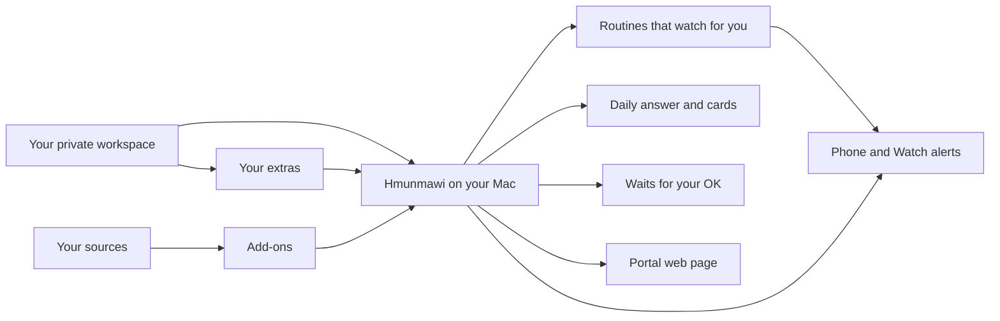
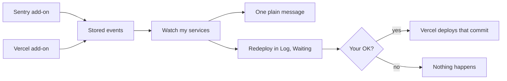
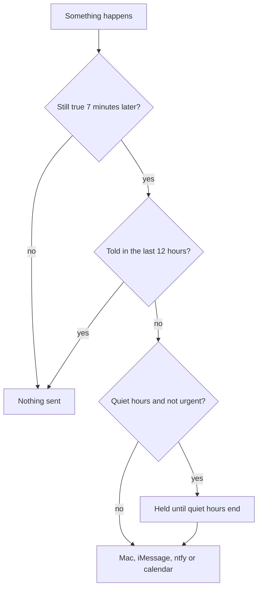
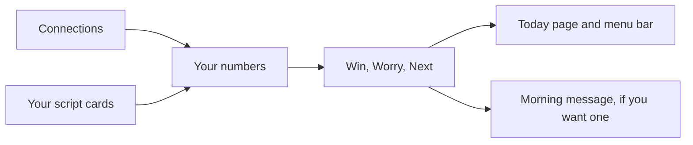

# What Hmunmawi can do

This is the single canonical list of capabilities. The README, the guide, the add-on guide, release notes and the
GitHub description all point here. When a capability is added, changed or removed in the code, change it here first
and keep everything else in step (see [the docs rule](../AGENTS.md#docs-rule-keep-the-capability-list-in-sync)).

Hmunmawi tracks, plans, queues and reminds. It never posts to YouTube, Instagram, Reddit, Discord or X for you, and
anything that changes something waits for your OK. Every row can be fed by your own scripts, kept in a private
repo of yours: see [Your private workspace](PRIVATE-WORKSPACE.md).

**Two words used below.** *Built in* means the app does it by itself once you connect a source. *From your
scripts* means the app shows and tracks it, but a script or AI job of your own produces it (see
[Your private workspace](PRIVATE-WORKSPACE.md#workflows-you-can-build)).

| Area | What it does | More |
|---|---|---|
| **Your daily answer** | Built in: one sentence each morning (Win, Worry, Next) from your own numbers, the Today page, a weekly story, and the menu bar "H" with a health dot and one number | [Guide](GUIDE.md#today-) |
| **Apple apps** | Built in: sales, subscriptions, reviews, ratings, releases and TestFlight; a Rejection Shield that catches what could get a version rejected, with fixes (attach a build, What's New, reviewer notes and contact) and **Submit for review**, each only after you confirm; TestFlight tidy-up; offer codes; featuring nominations; product page tests; review replies drafted for you to edit and posted only when you press Post; Day 1, 7 and 28 retention from an App Sessions file you add | [Guide](GUIDE.md#apps-), [Add-ons](ADD-ONS.md) |
| **Live sales** | Built in: sales the next morning (Apple's daily report), within minutes (Apple's notification history) or within seconds (a free relay the app sets up in your own Cloudflare account, taking only your own apps' notifications and kept up to date by the app: it updates the worker when a new version brings worker changes, or on **Update worker**) | [Guide](GUIDE.md#-connections), [Relay](ASC-WEBHOOK-RELAY.md) |
| **Websites and search** | Built in: visitors and AI-bot reads from Cloudflare; Google Search Console and Bing clicks, top searches and pages; a "website down" watch; next steps such as searches that have no page yet and pages Google shows on its first page that get under half your site's own click rate (rewrite the title; clicks are compared 14 days after you mark it Done); Vercel visitors and page views, and whether production runs your branch's newest commit (a failed or missing deploy is told once, and a **Redeploy** waits in Log → Waiting for your OK); **Check links on my site**, a weekly check of every outside link on your pages (dead only after two runs in a row; App Store links checked with Apple's lookup). From your scripts: a **Search health** card (Google, Bing and AI-search problems per site) with Fix buttons that run your own monitor script. Hmunmawi itself submits nothing to search engines | [Add-ons](ADD-ONS.md), [Search health](PRIVATE-WORKSPACE.md#search-health) |
| **Social** | Built in: YouTube subscribers, views and newest videos; X numbers, post drafts at your best hours, reply ideas (both kept to your topics, with an "never about" list and your **Words I never use**, and refused when they name an app version that isn't the current one), and unfollows: a daily list by hand or **automatic unfollows** (opt-in, a few a day through your own Safari login, frozen list, safety stops). From your scripts: Shorts plans, Instagram Reels and carousel to-dos, Reddit and Discord post ideas. Built in: one-tap **job switches** (Settings → Jobs) that turn each channel (Reddit, Discord, Instagram, YouTube Shorts, X), automatic X unfollows and each account's warm-up suggestions on or off in your workspace's switch file, which your scripts read | [Script feed](SCRIPT-FEED.md#post-ideas-and-to-dos), [Set up X](X-SETUP.md), [Job switches](PRIVATE-WORKSPACE.md#job-switches) |
| **Publishing** | From your scripts: articles and posts you produce show up as to-dos and as jobs on the Automations map: what is due, what ran, what failed. Nothing goes out until you say so | [Routines](ROUTINES.md), [Publishing](PRIVATE-WORKSPACE.md#articles-on-a-schedule) |
| **Outreach and mail** | Built in: an outreach list with follow-up reminders; **check before adding** (is the page there, an email or contact form, paid-only wording, the page's language, already on your list by name, website or address); a likely duplicate is noted, never refused; replies matched from Apple Mail or IMAP, each change waiting for your tap | [Routines](ROUTINES.md) |
| **Crashes and health** | Built in: crash-free sessions and freezes from Sentry; Sentry's open problems in plain words (a new crash, a website Sentry Uptime saw down, a job Sentry Crons saw late), told once and again when closed; a **Mac-alive heartbeat** to a Sentry Crons monitor, so Sentry tells you when this Mac or Hmunmawi stops; **Check my workspace Python**, which finds the venvs your scripts and Mac jobs use, tells you when an upgrade broke one and repairs it on your tap (only real venvs, with a `pyvenv.cfg`); key watch also tells you when a connection hasn't worked for a day; failed Mac jobs retried; stuck connections restarted; keys, certificates, profiles and domains watched for expiry; your own fix scripts run when disk space runs low, a website goes down, a Mac job fails or crashes jump | [Add-ons](ADD-ONS.md), [README: Self-healing](../README.md#everything-else) |
| **Money and offer codes** | Built in: payday date, monthly forecast, profit after your costs, AI credits and plan limits, an export for your accountant; offer codes handed out one by one and watched for expiry; **Plans and trials** you type in (a trial that ends, a plan that renews) reminded like a certificate. From your scripts: the Startup programs card | [AI and costs](AI-AND-COSTS.md) |
| **Alerts** | Built in: Mac notifications, iMessage, ntfy push and an iPhone and Watch calendar, with quiet hours; told once, only if it is still true 7 minutes later | [Guide](GUIDE.md#menu-bar-and-notifications-) |
| **AI limits** | Built in: plan limits shown, an alert at 80%, a monthly AI budget and a cap per AI routine; the AI job pause stops your own AI scripts when you need them to wait | [AI and costs](AI-AND-COSTS.md), [AI jobs](PRIVATE-WORKSPACE.md#running-ai-jobs-on-your-own-mac) |
| **Autopilot with approval** | Built in: routines on a schedule, your own scripts and Mac jobs (Run now, Pause and Resume on each job's row), on/off switches for the jobs your scripts run and for the jobs Hmunmawi runs for you (Settings → Jobs → Run by Hmunmawi), an optional **Keep this Mac awake** setting (off, while plugged in, always) so routines run on time, bots and agents such as Claude Code through `hm` and MCP; anything that changes something waits in Log → Waiting, and once you give agents badges, one without a badge always waits | [Routines](ROUTINES.md), [hm commands](HM-COMMANDS.md), [For AI agents](../AGENTS.md) |
| **Share and show** | Built in: share cards sized for posts and stories; your numbers as one web page (the portal) you host yourself, with a "safe to show anyone" copy; the Wall of Apps | [Portal](GUIDE.md#your-own-portal-), [Wall of Apps](WALL-OF-APPS.md) |
| **Your extras** | Built in: Settings → General → Your extras, for everyone: a workspace folder (Find my key and the job switch file look there), key and repositories folders for Find my key, the AI job pause card for your own AI runner, the Zoho Mail reader through your Safari login, X numbers from a file and a fixed time zone for every date; set in the app, by agents (`hm extras`, `hm set extras.*`) or from your workspace's `config/hmunmawi-extras.json`. Each row shows where it comes from. The Keychain-prompt watcher stays in builds you make yourself | [Guide](GUIDE.md#-general), [Workspace recipe](PRIVATE-WORKSPACE.md#your-extras-from-your-workspace) |
| **Install, updates, keys and backups** | Built in: a notarized app that updates itself after asking, with what changed in the update window and a one-time **What's new** card on Today after the update (**Start here** on a fresh install); keys only in your Keychain, and a key that came from a file (an App Store Connect `.p8`, a Google sign-in file) re-imported by itself after an update; daily backups, with an optional encrypted iCloud copy | [README: Your keys](../README.md#everything-else), [Releasing](RELEASING.md) |

## Built-in connections

App Store Connect, RevenueCat, PostHog, Sentry, Cloudflare, Vercel, Google Search Console, Bing Webmaster Tools, YouTube, X,
Script feed, Mac jobs, iMessage and ntfy. One folder each in `AddOns/`; see [ADD-ONS.md](ADD-ONS.md).

## How it fits together

In plain words:

1. Your **sources** (App Store Connect, Sentry, Vercel, search, YouTube, X and the rest) are read by small add-ons
   that never see your keys.
2. Your **private workspace** (optional) adds what no add-on knows: your own scripts, Mac jobs and AI jobs, and its
   extras file switches on **Your extras** (folders for Find my key, the AI pause card, the Zoho reader, a time zone).
3. **Hmunmawi** on your Mac turns all of it into the daily answer, cards, to-dos and the Automations map.
4. Routines Hmunmawi runs itself (Watch my services, the heartbeat, link and Python checks) read what the add-ons
   found and tell you in plain words.
5. Anything that would **change** something (a redeploy, a repair, a Shield fix) waits for **your OK**.
6. **Alerts** reach your phone and Watch, and the **portal** shows your numbers in any browser.

## How Watch my services works

In plain words:

1. The Sentry add-on reads your open problems every 30 minutes; the Vercel add-on reads your production deploy
   every 15 minutes.
2. The **Watch my services** routine compares them with what it saw last time (the first read only remembers).
3. Each new problem, and each closed one, becomes one plain sentence sent to you.
4. A deploy that failed, got stuck or never started for your branch's newest commit also puts a **Redeploy** in
   Log → Waiting.
5. Only when you approve it does Hmunmawi ask Vercel to deploy, and only the commit you approved.

## How an alert reaches you

In plain words:

1. Something happens: a sale, a 1-star review, a failed job, a site that stopped answering.
2. A problem must still be true **7 minutes later**, so a blip never wakes you.
3. The same problem is told at most once every 12 hours, and at most 6 notifications go out an hour.
4. In quiet hours it waits, unless it is urgent (a website down still goes out).
5. It goes where you chose: a Mac notification, iMessage, ntfy, or the Hmunmawi calendar on your iPhone and Watch.

## How the morning answer is made

In plain words:

1. Every connection checks in on its own clock (App Store Connect every hour, search every 6 hours, and so on).
2. Your scripts add their cards through the script feed every 10 minutes.
3. Each morning Hmunmawi writes one sentence from those numbers: what you won, what to watch, what to do next. No
   AI is needed; with an AI key, the morning story can add one line.
4. It shows on the Today page and in the menu bar, and a routine can send it to your phone.

