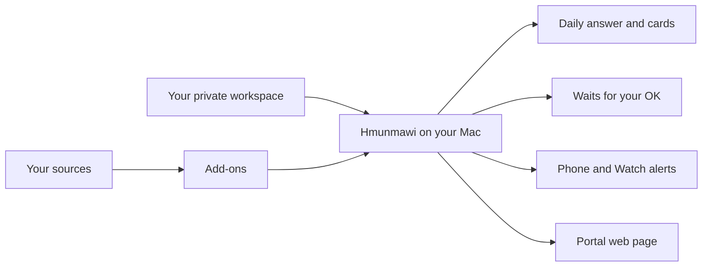
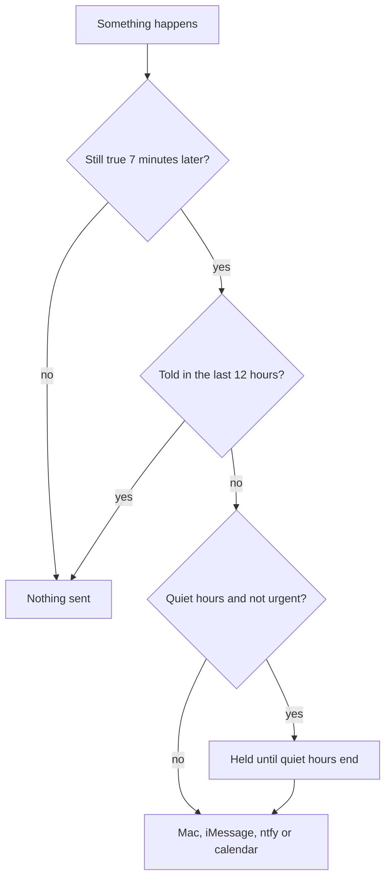
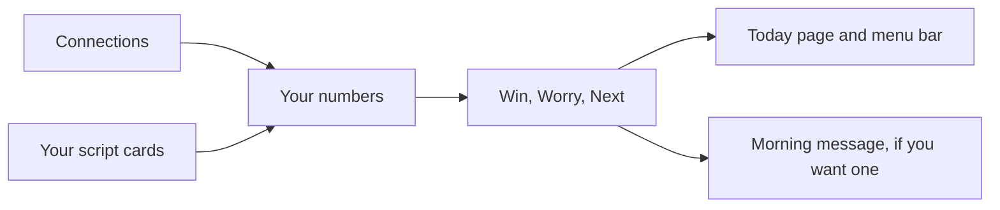

# What Hmunmawi can do

This is the single canonical list of capabilities. The README, the guide, the add-on guide, release notes and the
GitHub description all point here. When a capability is added, changed or removed in the code, change it here first
and keep everything else in step (see [the docs rule](../AGENTS.md#docs-rule-keep-the-capability-list-in-sync)).

Hmunmawi tracks, plans, queues and reminds. It never posts to YouTube, Instagram, Reddit, Discord or X for you, and
anything that changes something waits for your OK. Every row can be fed by your own scripts, kept in a private
repo of yours: see [Your private workspace](PRIVATE-WORKSPACE.md).

**Two words used below.** *Built in* means the app does it by itself once you connect a source. *From your
scripts* means the app shows and tracks it, but a script or AI job of your own produces it (see
[Your private workspace](PRIVATE-WORKSPACE.md#workflows-you-can-build)).

| Area | What it does | More |
|---|---|---|
| **Your daily answer** | Built in: one sentence each morning (Win, Worry, Next) from your own numbers, the Today page, a weekly story, and the menu bar "H" with a health dot and one number | [Guide](GUIDE.md#today-) |
| **Apple apps** | Built in: sales, subscriptions, reviews, ratings, releases and TestFlight; a Rejection Shield that catches what could get a version rejected, with fixes (attach a build, What's New, reviewer notes and contact) and **Submit for review**, each only after you confirm; TestFlight tidy-up; offer codes; featuring nominations; product page tests; review replies drafted for you to edit and posted only when you press Post; Day 1, 7 and 28 retention from an App Sessions file you add | [Guide](GUIDE.md#apps-), [Add-ons](ADD-ONS.md) |
| **Live sales** | Built in: sales the next morning (Apple's daily report), within minutes (Apple's notification history) or within seconds (a free relay the app sets up in your own Cloudflare account) | [Guide](GUIDE.md#-connections), [Relay](ASC-WEBHOOK-RELAY.md) |
| **Websites and search** | Built in: visitors and AI-bot reads from Cloudflare; Google Search Console and Bing clicks, top searches and pages; a "website down" watch; next steps such as searches that have no page yet. From your scripts: a **Search health** card (Google, Bing and AI-search problems per site) with Fix buttons that run your own monitor script. Hmunmawi itself submits nothing to search engines | [Add-ons](ADD-ONS.md), [Search health](PRIVATE-WORKSPACE.md#search-health) |
| **Social** | Built in: YouTube subscribers, views and newest videos; X numbers, post drafts at your best hours, reply ideas and an unfollow list. From your scripts: Shorts plans, Instagram Reels and carousel to-dos, Reddit and Discord post ideas | [Script feed](SCRIPT-FEED.md#post-ideas-and-to-dos), [Set up X](X-SETUP.md) |
| **Publishing** | From your scripts: articles and posts you produce show up as to-dos and as jobs on the Automations map: what is due, what ran, what failed. Nothing goes out until you say so | [Routines](ROUTINES.md), [Publishing](PRIVATE-WORKSPACE.md#articles-on-a-schedule) |
| **Outreach and mail** | Built in: an outreach list with follow-up reminders; replies matched from Apple Mail or IMAP, each change waiting for your tap | [Routines](ROUTINES.md) |
| **Crashes and health** | Built in: crash-free sessions and freezes from Sentry; failed Mac jobs retried; stuck connections restarted; keys, certificates, profiles and domains watched for expiry; your own fix scripts run when disk space runs low, a website goes down, a Mac job fails or crashes jump | [Add-ons](ADD-ONS.md), [README: Self-healing](../README.md#everything-else) |
| **Money and offer codes** | Built in: payday date, monthly forecast, profit after your costs, AI credits and plan limits, an export for your accountant; offer codes handed out one by one and watched for expiry. From your scripts: the Startup programs card | [AI and costs](AI-AND-COSTS.md) |
| **Alerts** | Built in: Mac notifications, iMessage, ntfy push and an iPhone and Watch calendar, with quiet hours; told once, only if it is still true 7 minutes later | [Guide](GUIDE.md#menu-bar-and-notifications-) |
| **AI limits** | Built in: plan limits shown, an alert at 80%, a monthly AI budget and a cap per AI routine; the AI job pause stops your own AI scripts when you need them to wait | [AI and costs](AI-AND-COSTS.md), [AI jobs](PRIVATE-WORKSPACE.md#running-ai-jobs-on-your-own-mac) |
| **Autopilot with approval** | Built in: routines on a schedule, your own scripts and Mac jobs, bots and agents such as Claude Code through `hm` and MCP; anything that changes something waits in Log → Waiting | [Routines](ROUTINES.md), [hm commands](HM-COMMANDS.md), [For AI agents](../AGENTS.md) |
| **Share and show** | Built in: share cards sized for posts and stories; your numbers as one web page (the portal) you host yourself, with a "safe to show anyone" copy; the Wall of Apps | [Portal](GUIDE.md#your-own-portal-), [Wall of Apps](WALL-OF-APPS.md) |
| **Install, updates, keys and backups** | Built in: a notarized app that updates itself after asking; keys only in your Keychain, and a key that came from a file (an App Store Connect `.p8`, a Google sign-in file) re-imported by itself after an update; daily backups, with an optional encrypted iCloud copy | [README: Your keys](../README.md#everything-else), [Releasing](RELEASING.md) |

## Built-in connections

App Store Connect, RevenueCat, PostHog, Sentry, Cloudflare, Google Search Console, Bing Webmaster Tools, YouTube, X,
Script feed, Mac jobs, iMessage and ntfy. One folder each in `AddOns/`; see [ADD-ONS.md](ADD-ONS.md).

## How it fits together

In plain words:

1. Your **sources** (App Store Connect, Sentry, search, YouTube, X and the rest) are read by small add-ons that
   never see your keys.
2. Your **private workspace** (optional) adds what no add-on knows: your own scripts, Mac jobs and AI jobs.
3. **Hmunmawi** on your Mac turns all of it into the daily answer, cards, to-dos and the Automations map.
4. Anything that would **change** something waits for **your OK**.
5. **Alerts** reach your phone and Watch, and the **portal** shows your numbers in any browser.

## How an alert reaches you

In plain words:

1. Something happens: a sale, a 1-star review, a failed job, a site that stopped answering.
2. A problem must still be true **7 minutes later**, so a blip never wakes you.
3. The same problem is told at most once every 12 hours, and at most 6 notifications go out an hour.
4. In quiet hours it waits, unless it is urgent (a website down still goes out).
5. It goes where you chose: a Mac notification, iMessage, ntfy, or the Hmunmawi calendar on your iPhone and Watch.

## How the morning answer is made

In plain words:

1. Every connection checks in on its own clock (App Store Connect every hour, search every 6 hours, and so on).
2. Your scripts add their cards through the script feed every 10 minutes.
3. Each morning Hmunmawi writes one sentence from those numbers: what you won, what to watch, what to do next. No
   AI is needed; with an AI key, the morning story can add one line.
4. It shows on the Today page and in the menu bar, and a routine can send it to your phone.

