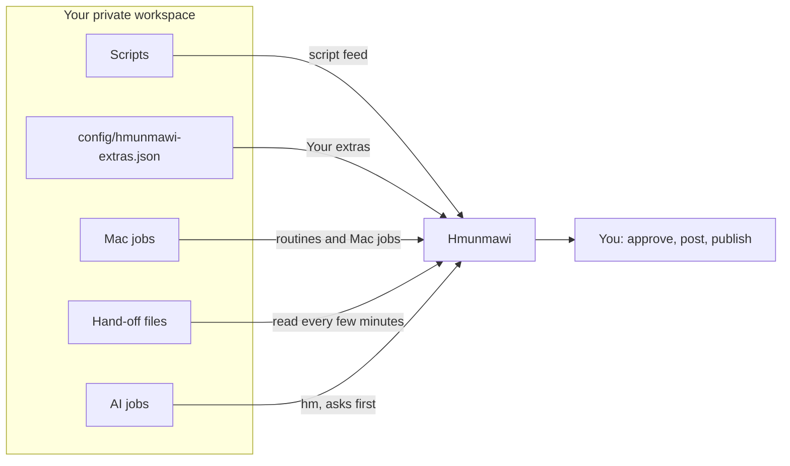
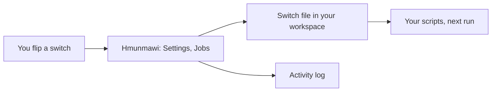
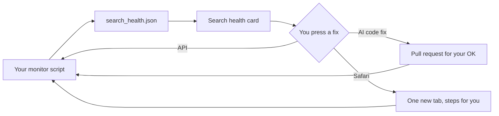
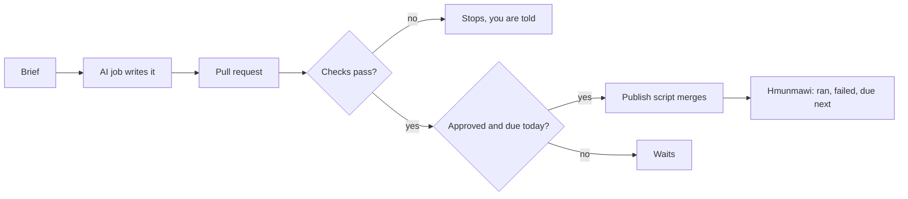
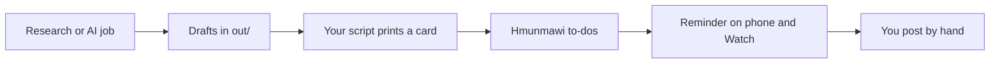
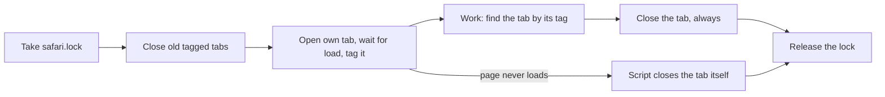
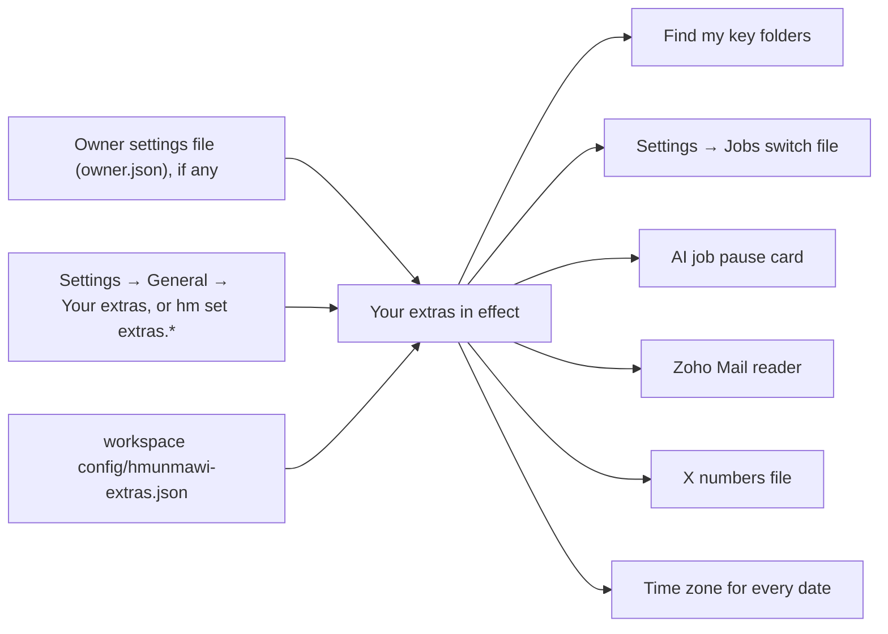
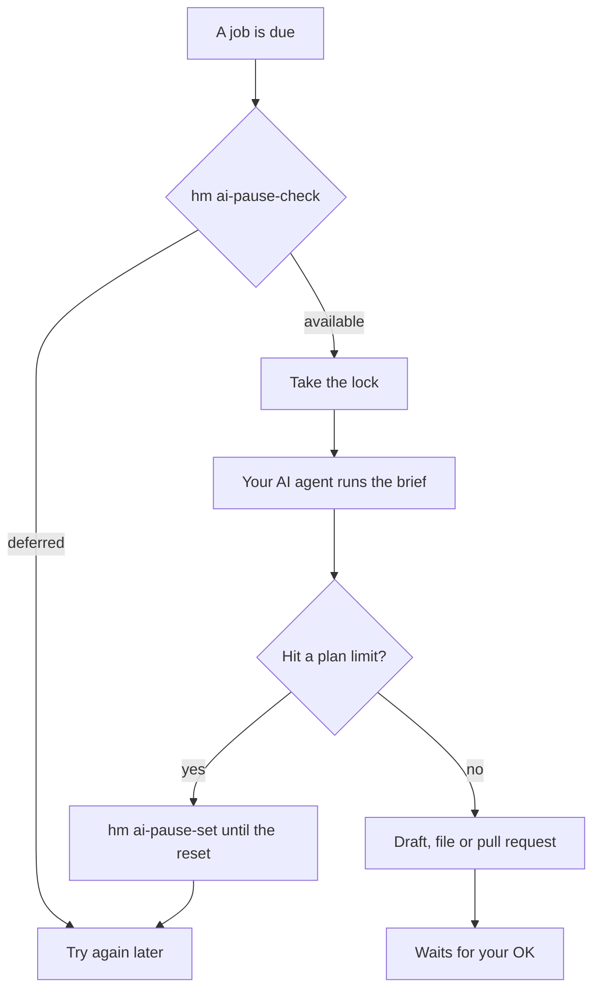
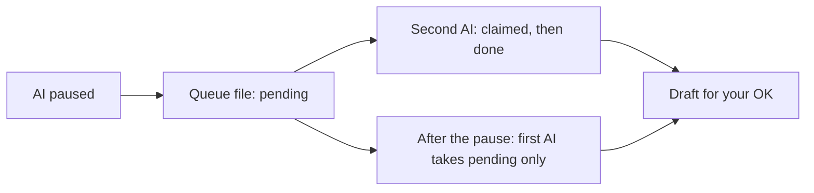

# Your private workspace

Hmunmawi is the public app. Your **private workspace** is a small private repository of your own: scripts, data,
drafts and notes that feed the app and that nobody else should see. Together they let one Mac run the whole
list in [CAPABILITIES.md](CAPABILITIES.md): your Apple apps, websites and search, social plans, publishing,
crash and money alerts, and autopilot with your approval.

You don't need one to use Hmunmawi. Everything built in works without it. Build one when you want Hmunmawi to
show and track things that no built-in connection knows about.

## The big picture

In plain words:

1. **Your workspace** holds scripts, small data files, AI briefs and drafts. It runs on your own Mac.
2. Your scripts hand their results to Hmunmawi in a few simple ways: a **script feed** that prints cards, **routines**
   and **Mac jobs** that run on a clock, a **job list** for jobs Hmunmawi can't see, and a few **hand-off files**
   it reads (search health, AI usage, X numbers).
3. **Hmunmawi** shows all of it next to its built-in connections: cards, to-dos, the Automations map and alerts.
4. Anything that would change something on an account waits for **your OK**. Posting is always yours.



The technical names: the script feed is an add-on that runs one script every 10 minutes; routines are in
`~/Library/Application Support/Hmunmawi/joblists/my-routines.json` (signed, change them only in the app or with
`hm`); job lists and hand-off files are described [below](#how-scripts-feed-the-app); agents use the `hm` command
or its MCP server ([HM-COMMANDS.md](HM-COMMANDS.md)).

## What it is, and why it is private

- **Hmunmawi** is the app: open source, on GitHub, the same for everyone.
- **Your workspace** is yours: a private repo (or just a folder) with your scripts, your numbers, your post and
  article drafts, your AI briefs and your keys.

Keep them apart. Your revenue, drafts, customer names and secrets stay off GitHub, and Hmunmawi stays something you
can update without touching your own work. Hmunmawi only remembers where your scripts are; it never copies them
anywhere ([Script feed](SCRIPT-FEED.md)).

## An example folder layout

Names are only a suggestion. Use whatever you like.

```text
my-workspace/
  STATE.md          what runs, what changed, what is planned (see the template below)
  AGENTS.md         rules for AI agents working in this repo (starter below)
  config/           switch file and hmunmawi-extras.json (Your extras, see below)
  scripts/          your scripts: feeds, jobs, checks
  data/             small files your scripts read and write (queues, lists, caches)
  briefs/           written instructions you give an AI agent for one job
  out/              reports and drafts your scripts produce
  secrets/          keys and tokens (gitignored, never committed)
  .gitignore
```

A `.gitignore` to start with:

```gitignore
# Keys and tokens never go to GitHub
secrets/
*.env
*.p8
*.pem
*.key

# Output and scratch files
out/
tmp/
*.log

# Personal exports (sales, mail, customer lists)
data/private/
.DS_Store
```

Make the repo **private** on GitHub, or don't push it at all and keep it in your normal backups.

## How scripts feed the app

There are five ways your scripts and Hmunmawi meet. Mix them freely.

1. **Script feed: a script that shows numbers.** In **Settings → Connections → Script feed** you give Hmunmawi the
   path to one script. Every 10 minutes it runs the script, which prints a little JSON, and Hmunmawi draws it as a
   card. The script has 2 minutes, must exit with 0 and should only read. Full format:
   [SCRIPT-FEED.md](SCRIPT-FEED.md).
2. **Routines: a script that runs on a clock.** **Automations → Your routines → Run my script** runs a script at
   the times you choose (with a time limit of 1 to 60 minutes, 10 by default), keeps its output, and has a **Try out** switch that runs it
   with `--dry-run` (or the word you choose) so you can test without changing anything. Details:
   [ROUTINES.md](ROUTINES.md).
3. **Mac jobs: scheduled jobs you already have.** The Mac jobs connection watches your scheduled jobs (launchd),
   flags the ones that fail and lets you **Run now** or **Pause**; a routine can also run one of them on a schedule.
   See [ADD-ONS.md](ADD-ONS.md).
4. **Job lists: jobs Hmunmawi can't see.** A script with its own scheduler, a bot or a cloud job can describe its
   jobs in a small JSON file of its own in `~/Library/Application Support/Hmunmawi/joblists/` (any name except
   `my-routines.json`). They appear on the Automations map with today's status. Format below.
5. **Hand-off files: things Hmunmawi reads directly.** A few cards read a file your script writes, instead of the
   script feed: see the table below.

### Job list format

```json
{
  "source": "My workspace",
  "who": "mac",
  "jobs": [
    { "id": "weekly-seo", "title": "Weekly search report", "detail": "Google and Bing, week over week",
      "at": "08:10", "days": ["Mon"],
      "last": { "date": "2026-11-17", "status": "ran" },
      "proof": "~/my-workspace/out/seo/{date}.md" }
  ]
}
```

- `who` is `mac`, `bot` or `cloud`. `at` is `HH:MM`, or use `"every": "5 min"`. `days` empty means every day.
- `last.status` is `ran`, `failed` or `missed`. Or give a `proof` file: when it exists (`{date}` becomes today's
  date), today's run counts as done.
- Keep the file under 500 KB. Hmunmawi only reads it; it never runs these jobs.

### Hand-off files

| File your script writes | What Hmunmawi does with it | Format |
|---|---|---|
| A script that prints JSON (script feed) | Cards, to-dos, the Startup programs card, events such as `disk.low` | [SCRIPT-FEED.md](SCRIPT-FEED.md) |
| `joblists/<name>.json` | Shows jobs it can't see on the Automations map | [Above](#job-list-format) |
| `search_health.json` | The Search health card with Fix buttons | [Search health](#search-health) |
| `config/hmunmawi-switches.json` (or `config/social_channels.json`) | On/off switches in Settings → Jobs; your scripts read them | [Job switches](#job-switches) |
| `usage/<name>.json` in Hmunmawi's data folder | A plan's usage under AI & subscriptions | [AI-AND-COSTS.md](AI-AND-COSTS.md#usage-file-format) |
| The X file | Your X numbers, best hours and glance | [X-FILE.md](X-FILE.md) |
| A bot's proof file and `problem-<job>-<date>.txt` in the shared bot folder | Tells you when a bot's job is late or failed | [ROUTINES.md](ROUTINES.md#bots) |
| A fix script you pick in Settings → General | Runs by itself when disk space runs low, a website goes down, a Mac job fails or crashes jump | [README](../README.md#everything-else) |

Hmunmawi's data folder is `~/Library/Application Support/Hmunmawi/`.

### Job switches

Turn a job off with a switch, not a code change. Keep one small JSON file of true/false values that your scripts
read at the start of each run; Hmunmawi shows each value as a switch in **Settings → Jobs**.

- **Where:** `config/hmunmawi-switches.json` in your workspace, else `config/social_channels.json`. Hmunmawi finds
  your workspace folder (Settings → General → Your extras → Workspace folder, or `hubRoot` in an owner settings file); set `switchFile` in an owner settings file to use another path, or press
  **Choose…** in Settings → Jobs.
- **What shows:** every top-level true/false, and every true/false one level down (`"warmed_up": {"reddit": true}`).
  Keys starting with `_` are notes. Well-known keys get a plain name and explanation: `reddit`, `discord`,
  `instagram`, `youtube_shorts`, `x` (a channel; a missing key means on), `x_unfollows` (Hmunmawi's automatic unfollows; a missing key means on), `instagram_drafts`,
  `new_instagram_carousels`, `instagram_warmup`, and `warmed_up.reddit` / `.discord` / `.instagram` (on = the account
  is already warmed up, so no warm-up steps; a missing key means off). Any other key shows as it is named; give it
  your own words with `"_labels"` and `"_help"`.
- **How it writes:** only the value you flip changes, in place, so your `_comment`, unknown keys, order and spacing
  stay as they were. A missing well-known key is added at the end of its object. The new file is checked, then
  written next to the old one and renamed over it, so a script never reads half a file. A value that isn't true or
  false, or a file that isn't valid JSON, is left alone and the tab says why. Each flip goes in the activity log.
- **Your scripts:** treat a missing file or key as the default and anything unreadable as "don't change behaviour".

```json
{
  "_comment": "Which social jobs run. Read by my scripts at the start of each run.",
  "reddit": true,
  "discord": false,
  "youtube_shorts": true,
  "x": true,
  "warmed_up": {"reddit": true, "discord": true, "instagram": false},
  "nightly_digest": true,
  "_help": {"nightly_digest": "The 22:00 summary message."}
}
```

```python
import json, pathlib
SWITCHES = pathlib.Path(__file__).resolve().parent.parent / "config/hmunmawi-switches.json"

def on(key: str) -> bool:          # a channel or job: missing = on
    try:
        return json.loads(SWITCHES.read_text()).get(key, True) is not False
    except (OSError, ValueError):
        return True

if not on("reddit"):
    raise SystemExit(0)            # switched off in Hmunmawi: do nothing this run
```

In plain words:

1. You flip a switch in Settings → Jobs.
2. Hmunmawi changes that one value in your switch file and logs it.
3. Your script reads the file at its next run and skips (or adds) that work.
4. To stop a whole scheduled job instead, press Pause on its row in Automations.



### A tiny example

`scripts/signups.py` prints one card. Replace the counting with your own backend or spreadsheet.

```python
#!/usr/bin/env python3
import json, time, datetime

today = datetime.date.today().isoformat()
signups_today, signups_week = 7, 42          # read these from your own source

print(json.dumps({"events": [{
    "kind": "section.snapshot",
    "app": "My backend",
    "occurredAt": int(time.time() * 1000),    # milliseconds, not seconds
    "dedupeKey": f"signups-{today}",
    "payload": {
        "id": "signups",
        "title": "Sign-ups",
        "page": "growth",
        "outcome": f"{signups_week} people signed up this week",
        "figures": [{"label": "Today", "value": signups_today},
                    {"label": "Last 7 days", "value": signups_week}],
        "items": [{"title": "Reply to new testers", "action": "Thank this week's sign-ups"}]
    }
}]}))
```

Run `chmod +x scripts/signups.py`, paste its full path in Settings → Connections → Script feed, **Allow** it, then
press **Check Now**. You can also ask your AI agent: "Write a Hmunmawi script feed that shows ..., following
docs/SCRIPT-FEED.md."

## How the work maps to what Hmunmawi can do

Hmunmawi tracks, plans, queues and reminds. It never posts to YouTube, Instagram, Reddit, Discord or X for you.
Your scripts (or an AI job you run) do the thinking and hand over cards, to-dos and drafts; you do the posting.

| You want | Your workspace does | Hmunmawi shows |
|---|---|---|
| **Apple apps** | Nothing needed. Connect App Store Connect and RevenueCat in Settings. Add scripts only for numbers from your own backend | Sales, subscriptions, reviews, releases, customer release subscriber lists and notifications, the Rejection Shield, offer codes |
| **Websites and search** | A script that checks a page, a sitemap or your analytics and prints a card; a routine can also watch a website address; a search health monitor writes `search_health.json` | Cloudflare, Vercel, Google Search Console and Bing numbers, "website down", deploy health with a Redeploy that waits for your OK, dead outside links (Check links on my site), next steps such as searches with no page yet and ranking pages nobody clicks, the Search health card and its Fix buttons |
| **Social: Shorts, Reels, carousels, Reddit, Discord, X** | A script or AI job writes plans and drafts into `out/` and prints a card whose `items` have an `action` (a plain sentence). X drafts can sit in a bank (`hm bank-add`) | To-do lines on a card, routine reminders, X drafts at your best hours, the Social posts group on the Automations map |
| **Publishing: articles and posts** | A job that produces the article or post file and a card saying what is due | To-dos and jobs on the Automations map: what is due, what ran, what failed |
| **Crashes and health** | Nothing needed for Sentry. A script can print a card for anything else, such as your own server health | Crash-free sessions, Sentry's open problems in plain words, the Mac-alive heartbeat, failed Mac jobs, broken Python environments, keys, certificates, plans and trials nearing expiry |
| **Money and offer codes** | A script can fill the Startup programs card; tools and plans are typed in the app | Payday, forecast, profit, AI credits, offer codes and their expiry |
| **Alerts** | Nothing needed. Alerts go out through iMessage, ntfy and the calendar | One message, only if it is still true 7 minutes later, with quiet hours |
| **Outreach and mail** | Nothing needed. Add outlets with `hm outreach-add` or in the app | Check before adding (`hm outreach-check`), a duplicate note on `outreach-add`, follow-ups due, replies matched from your mail, each change waiting for your tap |
| **AI limits** | A wrapper that asks `hm ai-pause-check` before each AI job and keeps one job at a time ([below](#running-ai-jobs-on-your-own-mac)) | Plan limits, the AI job pause, the monthly AI budget |
| **Autopilot with approval** | Scripts you trust become routines; agents call `hm` | Anything that changes something waits in Log → Waiting |

### Approval comes first

- **Reading never needs approval.** `hm status`, `hm data-read`, `hm routine-list` and the like just answer.
- **Changes wait for your OK.** Unless you allowed that kind of change in **Settings → Rules → Agents**, a request
  from an agent waits in **Log → Waiting**.
- **Scripts are yours alone.** Only you can add or change a script routine, in the app. An agent may run or pause
  one, never point it at a different command.
- **Your drafts are only drafts.** Nothing is posted, sent or changed on any platform without you.

The whole list of commands is in [HM-COMMANDS.md](HM-COMMANDS.md) and `hm guide`.

## Workflows you can build

Each recipe below is something a private workspace can run around Hmunmawi. For each one: what it is for, what
**your workspace** does, what **Hmunmawi** does, and where your OK comes in. Hmunmawi never posts, publishes or
merges anything by itself; where a recipe says "merge" or "post", that is your script or you.

<details><summary>Quick index</summary>

- [A daily numbers message](#a-daily-numbers-message)
- [Live purchase alerts](#live-purchase-alerts)
- [Crash alerts in plain words](#crash-alerts-in-plain-words)
- [Search health](#search-health)
- [Website checks and a pull-request gate](#website-checks-and-a-pull-request-gate)
- [Articles on a schedule](#articles-on-a-schedule)
- [Website language versions](#website-language-versions)
- [Social and content planning](#social-and-content-planning)
- [X post drafts and reply reminders](#x-post-drafts-and-reply-reminders)
- [Review reply drafts and store keyword ideas](#review-reply-drafts-and-store-keyword-ideas)
- [Win-back offers and offer-code checks](#win-back-offers-and-offer-code-checks)
- [A research job on a monthly AI budget](#a-research-job-on-a-monthly-ai-budget)
- [Morning batch and weekly pulse](#morning-batch-and-weekly-pulse)
- [Self-repair: disk space, failed jobs, keep-alive](#self-repair-disk-space-failed-jobs-keep-alive)
- [A bigger portal of your own](#a-bigger-portal-of-your-own)
- [Checked plan steps](#checked-plan-steps)
- [Search titles with a ledger](#search-titles-with-a-ledger)
- [Claims check in your PR gate](#claims-check-in-your-pr-gate)
- [Keep your workspace in step with GitHub](#keep-your-workspace-in-step-with-github)
- [Sentry uptime monitors](#sentry-uptime-monitors)

</details>

### A daily numbers message

- **For:** one short message each morning with yesterday's numbers.
- **Built in:** the morning story and the weekly digest (Automations → Your routines) already do this from your
  connections, by iMessage or ntfy.
- **Your workspace:** for numbers Hmunmawi doesn't have, a script prints a `section.snapshot` card through the script
  feed; it then counts in the same Today page. A script that sends its own message can run as a **Run my script**
  routine.
- **Your OK:** none needed; it only reads and tells you.

### Live purchase alerts

- **For:** hearing about a purchase or a renewal within seconds.
- **Built in:** Settings → Connections → App Store Connect → how fast sales arrive → *within seconds*. Hmunmawi deploys
  a small relay to **your own** Cloudflare account and shows its address; you paste that address into App Store
  Connect once ([how the relay works](ASC-WEBHOOK-RELAY.md)). A rule ("when a purchase arrives, text me") sends it on.
- **Your workspace:** nothing needed. If you already run your own receiver, a script can send its events through the
  script feed instead.

### Crash alerts in plain words

- **For:** one plain sentence per new crash or freeze, not a dashboard.
- **Built in:** the Sentry connection reads crash-free sessions and freezes (separating older-release freezes from the live build); ready-made rules alert on a crash spike. With `event:read` granted and **Watch my services** enabled (Automations → +), new open Sentry issues appear in plain words and `hm services` ranks non-hang crashes ahead of hangs and `mac-jobs-ok` rollups; **Apps → Stability** also offers a read-only **Copy brief for Claude** button when open crashes or live-release freezes need attention.
- **Your workspace:** Hmunmawi keeps Sentry strictly read-only, while your own workspace scripts or local Claude sessions can handle interactive triage, hang archival, or explanation notes in `out/` (code fixes always wait for you).

### Search health

- **For:** knowing when Google, Bing or AI search stops seeing your website, and fixing it in one place.
- **Your workspace:** a monitor script checks each site (sitemap, pages that fail, Search Console and Bing data,
  pages missing from an index) and writes `search_health.json`. Submitting pages to search engines (a sitemap ping,
  IndexNow, Bing URL submission) is the script's job: Hmunmawi's Bing and Search Console connections only read.
- **Hmunmawi:** a **Search health** card on the Today page, grouped under your projects, with **Problems and fixes**.
  Each fix button runs your monitor script; a Safari fix opens **one new tab** on Bing Webmaster Tools or Search
  Console after you confirm, stops at a sign-in, and closes only that tab when you press Done.
- **Your OK:** you press each fix. An "AI code fix" should only open a pull request; keep merging for yourself.

In plain words:

1. Your monitor checks the site and writes a report.
2. Hmunmawi shows the problems and the fixes your script offers.
3. You press a fix: your script calls an API, starts an AI job that opens a pull request, or Hmunmawi opens one
   Safari tab with steps for you.
4. Your script checks again and writes the new state; the card updates within a minute.



**Where Hmunmawi looks.** Pick the file once on a website project's empty Search health card (**Choose file…**).
Put the script at `scripts/search_health.py` in the folder **two levels above** the report, for example:

```text
my-workspace/
  scripts/search_health.py
  out/search/search_health.json
```

Without the script there, the card is **view only**. Hmunmawi runs it with the workspace's `.venv/bin/python` if
there is one, else `/usr/bin/python3`, from the workspace folder, with these arguments:

| Button | Arguments |
|---|---|
| Check again | `run --site <site id> --reason recheck` |
| An API fix | `fix --site <site id> --issue <issue id> --action <action>` |
| An AI code fix | `ai-fix --site <site id> --issue <issue id>` |
| After a Safari fix | `fix-status --site … --issue … --kind safari --state done\|failed --detail <text>` |

**The report** (only `sites`, each site's `id`, `name` and `issues`, and each issue's `id` are required):

```json
{
  "generated": "2026-11-20T07:05:00Z",
  "sites": [
    {
      "id": "example", "name": "example.com", "project": "My app", "origin": "https://example.com",
      "status": "amber", "checked_at": "2026-11-20T07:05:00Z",
      "issues": [
        {
          "id": "not-indexed", "severity": "moderate", "source": "bing",
          "title": "3 new pages are not in Bing yet",
          "plain": "Bing hasn't picked up this week's pages.",
          "urls": ["https://example.com/new-page"],
          "fix_paths": [
            { "kind": "api", "action": "submit_urls", "label": "Send them to Bing" },
            { "kind": "ai_code", "action": "fix_links", "label": "Ask my AI for a fix (pull request)" },
            { "kind": "safari", "action": "inspect", "label": "Open Bing Webmaster Tools",
              "start_url": "https://www.bing.com/webmasters/", "steps": ["Open URL inspection", "Request indexing"] }
          ],
          "fix_status": { "kind": "api", "state": "done", "at": "2026-11-20T07:10:00Z", "detail": "sent 3 pages" }
        }
      ]
    }
  ]
}
```

- `status`: `red`, `amber` or `green`. `severity`: `high`, `moderate` or `low` (low issues are not on the card,
  only in the detail).
- `fix_status.state`: `queued`, `deferred` (your AI is paused; it runs when the pause ends), `running`, `done` or
  `failed`.
- A Safari `start_url` must be on `www.bing.com/webmasters` or `search.google.com/search-console`; anything else is
  refused.

### Website checks and a pull-request gate

- **For:** changing your website safely, by hand or by an AI job.
- **Built in:** the **Watch a website** routine tells you after 2 failed checks in a row, and when it is back.
- **Your workspace:** one check script that every change must pass before it is merged (the site builds, every page
  has a title, description and canonical link, links work, the preview deploy is green). Your AI jobs open a pull
  request and run that script; only a pass may merge. Run the check script itself as a **Run my script** routine to
  see it on the Automations map.
- **Your OK:** decide which kinds of change may merge after a pass and which always wait for you, and write that
  in your workspace's AGENTS.md.

### Articles on a schedule

- **For:** a steady flow of researched articles without publishing by hand every time.
- **Your workspace:** an AI job writes each article from a brief into a branch and opens a pull request; your check
  script gates it; a small publish script merges an approved pull request only on its due date, checks the page is
  live, and tells search engines about it. A refill job writes new briefs when fewer than a week's worth are left.
- **Hmunmawi:** run the publish and refill scripts as routines (or Mac jobs); each run, failure and output shows on
  the Automations map, and a card from your script can list what is due this week as to-dos.
- **Your OK:** you approve each article (or a list of them) before its date; the publish script merges only those.

In plain words:

1. A brief goes in. An AI job writes the article and opens a pull request.
2. Your checks run. A failure stops it there.
3. On the due date, the publish script merges only articles you approved, then checks the page is live.
4. Hmunmawi shows what ran, what failed and what is due next.



### Website language versions

- **For:** deciding, with data, whether a translated version of your site is worth keeping.
- **Your workspace:** a script reviews each language a few weeks after launch, using Search Console and Bing numbers
  for that language's pages, and decides one next step: keep, fix indexing, improve, switch off, or start the next
  language. A small config file says which languages are live or paused, so the script and you agree. Any change it
  makes goes through the same pull-request gate.
- **Hmunmawi:** the script prints a card with the decision and the next language, and its runs show on the
  Automations map.

### Social and content planning

- **For:** YouTube Shorts, Instagram Reels and carousels, Reddit and Discord posts, and X, planned and reminded,
  never posted for you.
- **Built in:** YouTube and X numbers; X post drafts and reply ideas ([below](#x-post-drafts-and-reply-reminders)).
- **Your workspace:** a research or AI job writes plans and drafts into `out/` (a Short's script, a carousel's
  slides, a Reddit post for a community whose rules allow it). A script prints a `section.snapshot` card whose
  `items` each carry an `action`, one line per thing to do today. A Mac job whose name mentions a post, caption,
  Instagram or short is grouped under **Social posts** on the Automations map.
- **Hmunmawi:** the to-dos on a card, a **Remind me** routine at the times you choose, and the Hmunmawi calendar on
  your iPhone and Watch.
- **Your OK:** you post everything yourself. If a script uploads for you (a video upload script, for example), have
  it wait for your yes first.

In plain words:

1. A research or AI job writes plans and drafts.
2. Your script turns today's items into a card with one to-do each.
3. Hmunmawi shows the to-dos and reminds you at your times, on your phone if you like.
4. You post by hand. Your script marks the item done next time it runs.



### X post drafts and reply reminders

- **Built in:** **Post drafts from my bank** sends a few ready drafts a day at your best hours, ranked by X's
  published algorithm; **X reply ideas** sends one ready reply at each of your times; **X unfollow list** sends a
  short list to unfollow by hand, and **X unfollows (automatic)** (opt-in) unfollows a few a day for you through
  your Safari login from a frozen list (your workspace's `x` or `x_unfollows` switch turns it off). See [Set up X](X-SETUP.md).
- **Your workspace:** fill the bank with `hm bank-add` (from your own drafts or an AI job), or have a bot write its
  daily reply-targets file. A check that each draft's facts are still true (app versions, prices) belongs in the
  script that adds it.
- **Your OK:** you post and reply yourself; unfollows are yours by hand unless you add the automatic routine yourself in the app (agents can't).

### Review reply drafts and store keyword ideas

- **Built in:** new App Store reviews, with reply drafts proactively placed in **Log → Waiting** (`review.reply`) or editable on the Apps page; a reply is posted only when you approve or press Post and confirm, and can be undone. `hm review-list` gives an agent the reviews with no reply yet, and `hm review-reply` parks a draft in Log → Waiting (never posts directly).
- **Your workspace:** a batch AI job can draft replies or App Store keyword ideas into files for you to read. Keep
  them as files; changing your App Store listing stays a step you take.

### Win-back offers and offer-code checks

- **Built in:** offer codes handed out one by one, and warnings 30, 7 and 1 day(s) before a code expires.
- **Your workspace:** a script that creates win-back offers in App Store Connect, run as a **Run my script**
  routine with **Try out** on, so it only says what it would do until you switch Try out off. A second script can
  check that what your website says about a code (its end date) still matches App Store Connect and open a pull
  request when it drifts.
- **Your OK:** anything that creates an offer or changes your website goes through you or your gate.

### A research job on a monthly AI budget

- **For:** a bigger AI job (research, drafts for many articles) that must never spend more than you set.
- **Your workspace:** the job checks the AI job pause, takes the lock, runs within a fixed budget you write in its
  config, and writes drafts and pull requests that wait for you. If your provider gives you a monthly credit, the
  job spends only that.
- **Hmunmawi:** your AI spend and credits under **AI & subscriptions** (with a read-only key), the job's runs on the
  Automations map, and the pause card. See [Running AI jobs](#running-ai-jobs-on-your-own-mac).

### Morning batch and weekly pulse

- **For:** one AI pass each morning (what changed, what to draft) and a weekly read of your App Store numbers.
- **Built in:** **Ask AI about my numbers** does a weekly brief on your numbers, search terms or crashes, and costs
  nothing when there is nothing new.
- **Your workspace:** longer jobs run as routines through your AI wrapper, so they wait while AI is paused, and send
  their result as a card or a message.

### Self-repair: disk space, failed jobs, keep-alive

- **Built in:** a failed Mac job is started once more a minute later; stuck connections are restarted; missed runs
  catch up.
- **Your workspace:** a script that sends a `disk.low` event through the script feed when free space is low, and a
  **fix script** (a shell script, picked in Settings → General) that cleans up build caches. Hmunmawi runs the fix
  by itself, and waits for a new OK if the file changes. The same works for a website that is down, a Mac job that
  fails and a crash spike.

### Checked plan steps

- **For:** next steps that were researched before you see them, not guesses.
- **Built in:** Next steps are worked out from your own numbers, each with the figures behind it and measured 14
  days after you mark it Done. A plan step a script sends is hidden once the app version it names is live.
- **Your workspace:** a script or an agent (for example Claude Code, which can read your code and the vendor's
  docs) researches each step and sends it through the script feed as a `plan.step` event with its evidence and a
  `next_check` date. Hmunmawi shows it under Planned steps and drops it when it goes stale.
- **Why not built in:** an AI inside Hmunmawi can't read your code or the vendor's current docs, so its "check" would
  be more unverified text. The research belongs where the sources are.

### Search titles with a ledger

- **For:** pages that rank but nobody clicks get a better title, and you find out whether it worked.
- **Built in:** Next steps names pages Google shows on its first page that get under half your site's own click
  rate. Mark one Done when the new title is live: its clicks are compared 14 days later. For a longer or custom
  window, register it with `hm change-add` and the **Judge my changes** routine says keep, improve or undo.
- **Your workspace:** a script or AI job reads `hm data-read kind=growth.search`, drafts a new title and description,
  opens a pull request on your site, and keeps its own ledger (old title, new title, date) so you can revert.
- **Your OK:** the pull request and any revert are yours; Hmunmawi only suggests and measures.

### Claims check in your PR gate

- **For:** no page or post goes out with a claim you can't back up.
- **Built in:** Settings → General → **Words I never use**; drafts and reply ideas that use one are skipped.
- **Your workspace:** your pre-merge script runs `hm lint-text file=<changed file>` for each changed page and stops
  when the answer has `"clean": false` (each hit says which rule and why). Agents can add rules to
  `wording-rules.json` in Hmunmawi's folder.

### Keep your workspace in step with GitHub

- **For:** work merged elsewhere (a cloud agent's pull request, another Mac) reaching this Mac without anyone pulling.
- **Your workspace:** a Mac job that runs `git pull --ff-only` on your main branch every hour or so, and only logs
  and stops when git refuses (a local edit, a diverged branch). It never merges, rebases or resets. Hmunmawi shows it
  on the Automations map and tells you when it fails.

### Scripts that use Safari

Some scripts need a page that only your logged-in Safari can read (a mail list, a dashboard, X). Keep it tidy with the
same rules Hmunmawi follows, so your scripts and the app never trip over each other:

1. **Take the lock.** `flock` the file `~/Library/Application Support/Hmunmawi/safari.lock` (exclusive) while your
   script has a tab open, and release it when done (a crash releases it for you). Wait up to a few minutes for it;
   if it stays busy, try again at the next run.
2. **Open your own tab, tag it, close it.** Open the page in a new tab, wait until it has loaded, then set
   `window.name = "hm-auto:<owner>:<job>:<epoch>:<random>"` (a name set before loading is cleared by Safari) and do
   this in one AppleScript call that closes the tab itself if the page never loads. After that find the tab only by
   that name, never by its position or as "the last tab", and close it in a `finally` that always runs.
3. **Sweep leftovers.** At the start of a run, close tabs on your own sites whose name starts with `hm-auto:` and is more
   than two minutes old (a run that was killed left it).



The owner's hub does exactly this in one small Python module; every Safari job there, and every Safari job in
Hmunmawi, uses it, so there is never a leftover tab and never a job that fails because "its tab wasn't there".

### Sentry uptime monitors

- **For:** hearing that your website is down even when this Mac is off.
- **Your workspace / Sentry:** create the uptime monitors in Sentry's own web app (a minute per page). Hmunmawi
  doesn't create them, because they count against your Sentry plan.
- **Built in:** **Watch my services** tells you when Sentry Uptime sees a page down and when it's back; **Watch a
  website** checks from this Mac while it's on; the **Mac-alive heartbeat** makes Sentry tell you when this Mac
  itself stops.

### A bigger portal of your own

- **Built in:** Settings → Publish writes your numbers as one web page you host yourself ([the portal](GUIDE.md#your-own-portal-)).
- **Your workspace:** scripts that build a larger private site on top of the same data, kept behind a login. The
  guide shows [what that can look like](GUIDE.md#what-a-full-portal-can-look-like-the-maintainers-setup).

## Your extras from your workspace

Settings → General → **Your extras** lists what your own setup switches on. Choose your workspace folder there
(or let an agent run `hm set key=extras.workspace value=~/my-workspace`, which waits for your OK unless you allowed
Connections), then add `config/hmunmawi-extras.json` to the workspace:

```json
{
  "key_folder": "secrets",
  "repos_folder": "~/code",
  "ai_pause_card": true,
  "zoho_mail": false,
  "x_file": "data/x_numbers.json",
  "time_zone": "Europe/Berlin"
}
```

| Key | What it switches on |
|---|---|
| `key_folder` | A folder of `.env` and key files that **Find my key** looks in first. Read only when you press Find my key; never sent anywhere. Keep it gitignored. |
| `repos_folder` | A folder of projects Find my key also looks through (up to 40). |
| `ai_pause_card` | The **AI job pause card** on Today and in the menu bar, for your own AI runner ([below](#queueing-limits-and-pause)). |
| `zoho_mail` | Offers **Zoho Mail (your Safari login)** in Settings → Connections → Mail, for Zoho plans without IMAP. |
| `x_file` | Your **X numbers file** ([format](X-FILE.md)), when none is set in Settings. |
| `time_zone` | A **fixed time zone** for every date and "today" in the app (an IANA name such as `America/New_York`). |

Every key is optional. Relative paths are inside the workspace; `~` and full paths work too. The workspace folder
itself is set only in Settings (a file can't move the folder it lives in). Without this file, the workspace folder
alone already makes Find my key look in it and lets Settings → Jobs find `config/hmunmawi-switches.json` or
`config/social_channels.json`.



Order, highest first: an owner settings file, then Settings, then the workspace file. A choice in Settings wins, so
switching the Zoho reader off in the app keeps it off even if the file says `true`; `hm set key=extras.zoho_mail
value=none` goes back to the file. A file that isn't valid JSON, or has a wrong type (say `"ai_pause_card": "yes"`),
switches nothing on, and Settings names the problem. Agents see the same list with `hm extras` (each extra's
state, value, where it comes from and whether an agent may set it).

**What stays owner-only, and why.** The **Keychain-prompt watcher** is built into the app by `scripts/make-app.sh`
on your own Mac (`HM_FLAVOR=owner`, with your watcher script in `HM_KEYCHAIN_WATCH`, which stays outside the repo);
the published, notarized app can't carry anyone's own script, so it shows as "Not in this build" there. Safari steps
through another program, the owner's own AI-pause script, typed keys kept in recovery files and Wall of Apps
welcome drafts also stay in the owner settings file: each runs a program you name, keeps keys outside the
Keychain, or is the project maintainer's job.

## Running AI jobs on your own Mac

AI is optional. When you want it, there are three places it can run:

- **Your own AI session on your Mac.** Your scripts can start an agent you already use, such as Claude Code, with a
  brief from `briefs/`. Hmunmawi does not start it for you and does not need to know your login.
- **Apple's on-device AI.** Free and private on a Mac with Apple Intelligence (macOS 26 or later). Hmunmawi uses it
  itself for X reply ideas and mail reply reading; nothing leaves the Mac
  ([AI-AND-COSTS.md](AI-AND-COSTS.md#apples-on-device-ai)).
- **A provider key you add in Settings.** Claude, OpenAI, Gemini, Ollama (free, on your Mac) and others, with a
  monthly limit you set and, per AI routine, its own monthly cap.

### Queueing, limits and pause

What the app supports today:

- **One AI job at a time.** Hmunmawi has no job queue of its own. If your scripts run AI jobs, run them through one
  small wrapper script that creates a lock file while a job runs. Hmunmawi's AI routines wait while that file
  exists (the `HMAILockFile` setting, see [ROUTINES.md](ROUTINES.md#safety)); a lock older than an hour counts as
  stale so it can't block forever.
- **Pause.** `hm ai-pause-set until=<time> reason=<text>` (up to 30 days) or `indefinite=true` pauses your AI jobs;
  `hm ai-pause-clear` lifts it. Your wrapper script asks `hm ai-pause-check` before it starts a job: it answers
  available or deferred. If it says deferred, the wrapper exits and tries again later.
- **Limits.** Plan limits are shown under **AI & subscriptions**, with an alert rule at 80%. Spend is capped by your
  monthly AI limit.
- **Hmunmawi never starts a paid AI call without a key you added.**

In plain words, one AI job from start to finish:

1. A job is due (a routine, a Mac job or you).
2. The wrapper asks Hmunmawi whether AI may run now. If it is paused, the job waits for a later run.
3. The wrapper takes the lock, so only one AI job runs and Hmunmawi's own AI routines wait.
4. Your AI agent does the job from its brief.
5. If the agent stops at a plan limit, the wrapper pauses AI until the limit resets, so nothing else tries in vain.
6. The result is a draft, a file or a pull request. It waits for your OK.



A wrapper can be this small:

```sh
#!/bin/sh
# scripts/ai_job.sh <brief-file>   one AI job at a time, only when not paused
LOCK="$HOME/.my-workspace/ai.lock"
mkdir -p "$(dirname "$LOCK")"
hm ai-pause-check 2>/dev/null | grep -q '"available"' || { echo "AI paused, try later"; exit 0; }
[ -n "$(find "$LOCK" -mmin -60 2>/dev/null)" ] && { echo "another AI job is running"; exit 0; }  # older = stale
touch "$LOCK"
trap 'rm -f "$LOCK"' EXIT
# start your own AI agent here, giving it the brief at "$1"
```

`hm` prints its answer as JSON, with `"result":"available"` or `"result":"deferred"`, so the wrapper looks for the
word. Run `hm ai-pause-check` once by hand to see it on your copy.

When your agent reports a plan limit, the wrapper can pause every AI job until that limit resets, for example
`hm ai-pause-set until=2026-11-27T10:00:00Z reason="weekly limit"`. Setting a pause needs the "spending" permission
for agents (Settings → Rules → Agents); without it the request waits for your OK.

### A second AI while the first is paused (optional)

If you use two AI tools (for example a coding agent and a chat bot), you can let the second one pick up some jobs
while the first is paused. Hmunmawi does not run this; it is a pattern for your workspace:

1. When the wrapper gets "deferred", it writes the job to a small queue file in `data/` with the status `pending`,
   but only for jobs you listed as safe to hand over (drafts, not merges).
2. The second AI takes a `pending` job, marks it `claimed`, does it, and marks it `done` with the path of its output.
3. When the pause ends, the first AI takes only jobs that are still `pending`. A `done` or `claimed` job is never
   done twice.
4. Jobs that change your website or spend money are not on the list; they wait for the pause to end.



If the second AI is a bot without a shell, list its job as a bot routine with a proof file
([ROUTINES.md](ROUTINES.md#bots)), so Hmunmawi tells you when it is late.

## STATE.md: a blank template

`STATE.md` is the work log for you and for your agents. One line per change, newest at the bottom.

```markdown
# STATE

What runs on its own, what is planned, who owns it. Update after every change.

## Running

| Job | When | What it does | Owner |
|---|---|---|---|
|  |  |  |  |

## Planned

-

## Log

| Date | What changed | Report |
|---|---|---|
| YYYY-MM-DD |  | out/reports/<name>.md |
```

### How agents should use it

- **Read `STATE.md` first**, before planning or changing anything.
- **Update it after acting**: the date, what changed, and a link to the report in `out/`.
- Keep entries short and true. Never put keys, customer names or exact private figures in it if the repo might ever
  be shared.

## AGENTS.md (or CLAUDE.md) starter for your private repo

Copy this to the root of your workspace and edit the parts in angle brackets.

```markdown
# Notes for AI agents in this workspace

Read STATE.md before planning or changing anything. Update it after acting.

## Rules
- Secrets live in the macOS Keychain or in files under secrets/ with permissions 0600. Never print them, paste them
  into chats or reports, or commit them.
- Scripts that feed Hmunmawi only read and print JSON (see Hmunmawi's docs/SCRIPT-FEED.md). Anything that changes
  something goes through Hmunmawi (`hm`) so it waits for my OK.
- Never post, reply, send or publish for me on any platform. Produce drafts (`hm outreach-send`, `hm release-notify-draft`, `hm review-reply` park drafts in Log → Waiting for my OK; `hm approve` refuses external actions).
- Check drafts and pages against my Words I never use with `hm lint-text` before handing them over. Submitting (`shield-fix item=submit`), redeploys (`deploy-redeploy`), Python repairs (`python-repair`), key changes (`set-key`), deletions (`remove-*`), and `publish` always wait for me even under Smart Autopilot.
- Use your Hmunmawi agent badge (`HM_AGENT_TOKEN`): once badges exist, a request without one always waits for me.
- Mac jobs: only `<your job prefix>.*` jobs; Hmunmawi refuses others and never touches `com.apple.*`.
- Before running an AI job, check `hm ai-pause-check`; if it says deferred, stop.
- One AI job at a time (use scripts/ai_job.sh).
- If a handed-over job in the queue file is `done` or `claimed`, don't do it again; take only `pending` ones.
- Website changes go through a pull request and scripts/<your check script>; merge only when it passes, and only
  the kinds of change listed here: <list them>.
- Test with --dry-run first.
- To turn an existing job or channel off, flip its switch (Hmunmawi Settings → Jobs, or the switch file); never
  change code for that. A new job that can be switched off reads its key from the switch file.
- Every new scheduled job goes in STATE.md, and in a Hmunmawi routine or job list so it shows on the Automations
  map.

## Docs rule: keep the capability list in sync
Every docs, README, release-note or description update about this workspace or Hmunmawi must check and keep the
full capability list in sync (Apple apps, websites and search, social: YouTube Shorts, Instagram Reels and
carousels, Reddit, Discord, X; publishing; crashes; money and offer codes; alerts; AI limits; autopilot with
approval). Never under-sell or drop a capability; verify claims against the code. The single canonical list is
Hmunmawi's docs/CAPABILITIES.md.

## Commit rules
- Small commits with a plain description. <your own rules>
```

## Secrets

- **Keychain first.** Hmunmawi keeps its own keys only in the macOS Keychain, and add-ons never see them
  ([SECURITY.md](../SECURITY.md)). Add a key with `hm set-key connection=<id> field=<key> value=-`, which reads it
  from standard input, never from the command line.
- **Your scripts' keys** go in the Keychain too (read with the `security` command), or in a file under `secrets/`
  that only you can read: `chmod 600 secrets/<service>.env`.
- **Never commit a key.** `secrets/` and `*.env` are in the `.gitignore` above. Check with `git status` before every
  commit, and keep keys out of `STATE.md`, briefs, reports and chat messages.
- **Read-only keys where you can.** A key that can only read cannot cause damage if it leaks.
- If a key is ever committed, treat it as leaked: revoke it at the service and make a new one.
