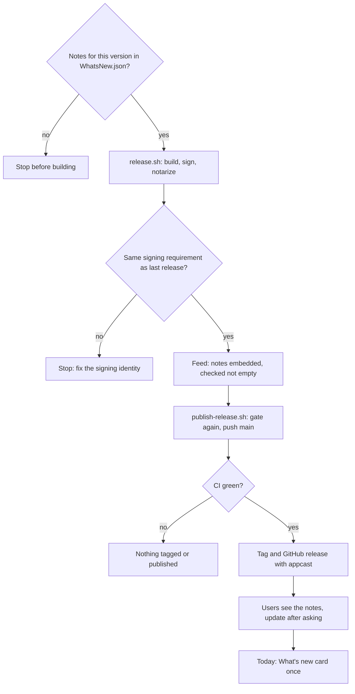

# Releasing Hmunmawi

A public build must open on any Mac without a warning. That needs Apple's **Developer ID Application** certificate,
the hardened runtime, Apple's notary check and a stapled ticket. `scripts/release.sh` does all of it.

## One-time setup (the account holder)

1. **Developer ID Application certificate.** Xcode → Settings → Accounts → your team → *Manage Certificates…* →
   **+** → *Developer ID Application*. (Only the Account Holder, or an Admin allowed by them, can create one.) It goes
   into your login keychain; `security find-identity -v -p codesigning` then lists it.
2. **Notary credentials**, one of:
   - an App Store Connect **team** API key with the *Developer* role or higher:
     `NOTARY_KEY=~/path/AuthKey_ABC.p8 NOTARY_KEY_ID=ABC NOTARY_ISSUER=<issuer uuid>`, or `NOTARY_ASC_CONFIG=<config.toml>`
     with `issuer_id`, `key_id` and `private_key_path`;
   - or a saved profile: `xcrun notarytool store-credentials hmunmawi-notary` (then `NOTARY_PROFILE=hmunmawi-notary`).

## Each release

Before tagging, tick the docs checklist: Every docs, README, release-note or GitHub description update must check and keep the full capability list in sync (Apple apps, websites and search, social: YouTube Shorts, Instagram Reels and carousels, Reddit, Discord, X; publishing; crashes; money and offer codes; alerts; AI limits; autopilot with approval). Never under-sell or drop a capability; verify claims against the code. The single canonical list is [docs/CAPABILITIES.md](CAPABILITIES.md); other docs point to it, including [PRIVATE-WORKSPACE.md](PRIVATE-WORKSPACE.md) and the AGENTS.md starter inside it. The release notes and the GitHub release description must not drop any capability either.

```sh
# bump CFBundleShortVersionString / CFBundleVersion in Resources/Info.plist, update CHANGELOG.md, add the version's
# user-facing notes at the top of Resources/WhatsNew.json, then:
NOTARY_PROFILE=hmunmawi-notary scripts/release.sh
```

It builds the `release` configuration as a **public** flavour (no owner extras, no Keychain-prompt watcher),
signs every helper and the app with the Developer ID certificate, hardened runtime and secure timestamp, sends the
zip to Apple (`notarytool submit --wait`), staples the ticket, validates it, runs `spctl --assess` and leaves
`build/Hmunmawi-<version>.zip` ready to upload.

If no Developer ID certificate exists the script stops (exit 3) and says which step above is missing. It never makes
a certificate itself.

**Signature gate.** `release.sh` (after building) and `publish-release.sh` (before pushing) run
`scripts/check-designated-requirement.sh`, which compares `codesign -d -r-` of the new build with the newest earlier
GitHub release (downloaded with `gh`) and **fails on any difference**. macOS ties Full Disk Access, Files & Folders,
Calendars, Accessibility, Automation and Keychain "Always Allow" to that requirement, so a different one makes every user
re-grant everything after updating. There is no override: fix the signing identity instead. Check by hand:
`scripts/check-designated-requirement.sh build/Hmunmawi-<version>.zip [previous.zip|previous.app|requirement.txt]`.

Then publish with `scripts/publish-release.sh <version>`. It pushes `main`, waits for the **CI** workflow on that
commit to pass, and only then tags `v<version>` and publishes the GitHub release with the zip and `appcast.xml`
(notes from the matching CHANGELOG.md section). If CI fails or never starts, nothing is tagged or published. Never
tag or run `gh release create` by hand before CI is green. CodeQL runs separately and slowly; check its alerts after.

**Release notes, one source.** `Resources/WhatsNew.json` holds the user-facing notes, newest first (1-3 short items
per version, each with an optional button: `settings:<pane>` or `page:<today|apps|log|automations>`). `release.sh`
stops before building when the version has none; after notarizing it writes them with `scripts/release-notes.py html`
next to the zip, `generate_appcast --embed-release-notes` puts them in the feed item's `<description>` (this version
and the four before it, so someone who skipped updates still reads what changed), and `release-notes.py check` stops
the release if the feed item ends up without notes. The app bundles the same file for Today's one-time **What's new**
card (`WhatsNewCard`, `WhatsNew` in HmunmawiCore); `WhatsNewFileTests` fails when the current version has no entry.
CHANGELOG.md stays the developers' record.

### The release gate, as a picture

In plain words:

1. `release.sh` builds, signs with Developer ID and gets Apple's notary ticket.
2. The signature gate compares the new build's signing requirement with the previous release. Any difference stops
   the release, so an update never asks users for permissions or keys again.
3. `publish-release.sh` runs the gate again, pushes `main` and waits for CI.
4. Only when CI is green is the tag made and the GitHub release published with the zip and `appcast.xml`.
5. Users' copies find the update through the signed appcast and install it after asking.



## Owner builds

Your own Mac's builds (`scripts/make-app.sh`) keep the Apple Development signature so saved Keychain keys keep working
across rebuilds, and, with the git-ignored marker `scripts/.owner-build`, include the owner-only Keychain-prompt
watcher. `HM_FLAVOR=public`, and `scripts/release.sh` always, leave that watcher out, so public releases never contain it. Owner extras in the app itself come from `owner.json` in the app's data folder (see `OwnerConfig`); everyone else's extras come from Settings → General → Your extras or the workspace file `config/hmunmawi-extras.json` (see `Extras`), which need no special build. The watcher row in Your extras reads "Not in this build" in a public release.

## Keychain names after a bundle id change

Saved keys live under the Keychain service `io.github.priyevsingh.Hmunmawi.keys.v2`, trusted by the app's designated
requirement (bundle id + certificate). A Developer ID build has a different certificate, so it cannot read items
saved by a development build without a prompt: a first public build starts with empty keys, which is right for new
users. Never rename the service or bundle id for an existing install without adding the old name to
`LegacySecretMigrator.legacyServices`.

## Testing a fresh install

`scripts/fresh-copy.sh build/Hmunmawi.app --reset --launch` runs a sealed-off copy (own bundle id, own data folder,
keys in memory only). `scripts/launch_smoke.sh` does the same for a 60-second crash check. Neither touches your real
app, Keychain, preferences, database or live stream.

## Signing and saved keys

- Saved keys are Keychain items whose access list trusts the app's **designated requirement**: its bundle id,
  Apple's anchor and the leaf certificate's name. Any build signed with the same certificate name reads them with no
  prompt; a renewed certificate keeps the name, so it keeps working. Ad-hoc signing or a different certificate does
  not.
- `scripts/make-app.sh` signs with `SIGN_ID`, else the identity pinned in `scripts/.sign-id` (git-ignored), else
  your only Apple Development certificate. It stops if the pinned identity isn't in the keychain, warns loudly on
  ad-hoc, and prints the certificate name it used. Never sign "just once" with another certificate: keys saved by
  that build are unreadable to normal builds.
- Check keys with `Hmunmawi --verify-secrets` (ok/fail only, never values; a connection satisfied by another
  credential, such as YouTube's Google sign-in, counts as ok) and copy them forward after a certificate change with
  `--rebind-secrets`. At every launch the app also re-imports keys from their saved files in the background and
  re-saves keys it can't read in a fresh Keychain item, so a changed certificate recovers on its own.
- Don't change `KeychainSecretStore.service`. If you ever must, add the old name to
  `LegacySecretMigrator.legacyServices` so the next launch copies keys forward. (The data protection keychain, which
  needs no access list, requires a provisioning profile; see SECURITY.md "Keychain: why there is never a password
  box".)

## Thanking new Wall of Apps entries

For the release notes, print a welcome line for every app that joined since the last release:

```sh
python3 scripts/wall-of-apps.py --since 2026-11-14   # the previous release's date
```

## Repository settings

`scripts/github-settings.sh` applies the repository's GitHub settings with the `gh` CLI: squash merges only, merged
branches deleted, sign-off required on web edits, only GitHub's own Actions with a read-only token, Dependabot alerts
and security updates, and, for a public repository, approval before outside contributors' workflows run, secret
scanning with push protection, private vulnerability reporting, CodeQL code scanning, and rulesets that protect
`main` (no force pushes, no deletion, no bypass for anyone) and the `v*` release
tags (no moving or deleting; only the maintainer can bypass, to publish releases). `main` has no "require a pull request" rule on purpose: the Wall of Apps workflow commits its rebuilt mosaic straight to `main`, and GitHub lets the Actions app bypass rules only on organization repositories. Outside contributors cannot push at all; they fork and open a pull request. Run it after creating the repository and again after
making it public; it says which settings it applied and which aren't available yet.
