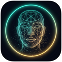
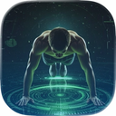

# Wall of Apps

Apps shipped by indie developers who use Hmunmawi, newest first. Add yours from the app: Settings → About → Wall of Apps.

**3 apps**

| | App | Developer | Joined |
|---|---|---|---|
|  | [Body Vitals: Health Widgets](https://apps.apple.com/us/app/body-vitals-health-widgets/id6760609127) | Priye Singh | 2026-11-14 |
|  | [Presence: Glow Up, Face Rating](https://apps.apple.com/us/app/presence-glow-up-face-rating/id6761987763) | Priye Singh | 2026-11-14 |
|  | [RepSquad: Workout With Friends](https://apps.apple.com/us/app/repsquad-workout-with-friends/id6756504196) | Priye Singh | 2026-11-14 |
