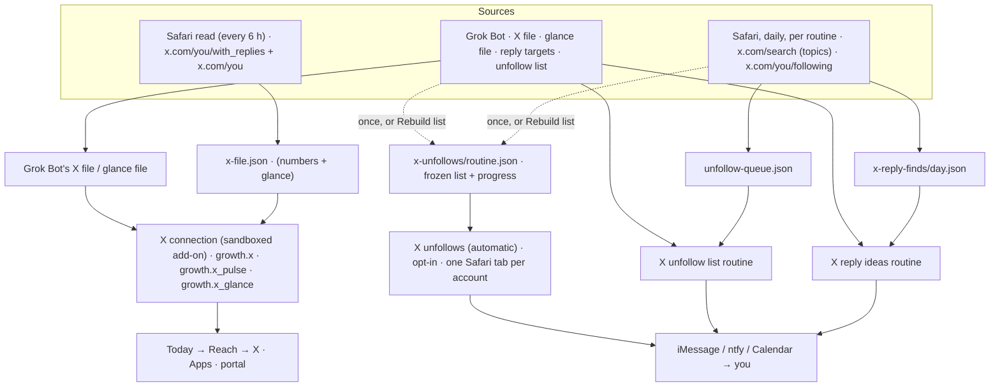

# X in Hmunmawi: technical reference

How every X feature works, what it reads, what it decides and where its limits are. The people-facing setup is
[X-SETUP.md](X-SETUP.md); this page is for the curious, for contributors and for agents.

**Ground rules, everywhere:** Hmunmawi never posts, replies, likes or follows. It unfollows only if you add the opt-in
**X unfollows (automatic)** routine yourself, and then only by clicking the profile's own button in your signed-in
Safari ([below](#automatic-unfollows-does-x-unfollows)). It never calls X's paid API and never calls X's private API
from your session. It reads files Grok Bot saves, or pages X already loaded in your own signed-in Safari, and hands
you checked suggestions.

## Data flow

In words:

- **Sources:** Grok Bot's files (X file, glance file, reply targets, unfollow list), a Safari read every 6 hours of your own X pages (`with_replies` and your profile), and a daily Safari read per routine (topic searches and who you follow).
- The Safari reads write the **same file shapes** Grok Bot does: `x-file.json` (numbers and glance), `x-reply-finds/day.json` and `unfollow-queue.json`.
- The sandboxed X connection (add-on) turns the X file into `growth.x`, `growth.x_pulse` and `growth.x_glance`, shown in Today → Reach → X, Apps and the portal.
- The X reply ideas routine and the X unfollow list routine read the finds, the unfollow queue and Grok Bot's files, then send results to you by iMessage, ntfy or Calendar.
- The opt-in X unfollows (automatic) routine makes a frozen list once (your Following page, scrolled, or Grok Bot's file) in `x-unfollows/<routine>.json`, then unfollows a few a day in Safari and tells you only when it stops and once a day.

The same flow as a diagram (plain text in some viewers; the list above says the same):

The Safari route writes **the same file shapes** Grok Bot does, so both routes go through one set of checks.

## The Safari reader

`Sources/HmunmawiApp/XSafariReader.swift` (tabs) and `Sources/HmunmawiCore/XNative.swift`,
`XSafariFinds.swift` (pure parsing and choices, unit tested).

- Opens one **background tab** in Safari's front window, runs a read-only script in it every 2 s until the page
  answers (up to ~30 s), then closes **only that tab**. Needs Safari → Develop → *Allow JavaScript from Apple Events*
  and the Automation permission for Safari (checked first, never prompted mid-run).
- Only `https://x.com/` URLs with URL-safe characters are opened (search queries are percent-encoded).
- The script finds X's in-page data store (React's `store.getState().entities`) and reads what's already loaded. It
  never clicks, scrolls the page for you, or sends requests.

| Read | Pages | Fields used | When |
|---|---|---|---|
| Numbers and glance | `/<you>/with_replies`, `/<you>` | user `followers_count`, `friends_count`, `pinned_tweet_ids_str`; per post `created_at`, `full_text`, `views.count`, `favorite_count`, `reply_count`, `retweet_count`, `quote_count`, `bookmark_count`, `in_reply_to_screen_name`, `article` → `publishedArticles[id].title` | every 6 h while *Read via your Safari login* is on |
| Reply ideas | `/search?q=…&f=live` | per post author `screen_name`, `followers_count`, text, time, likes, replies | first reply time each day, `source=safari` |
| Unfollow list | `/<you>/following` | per user `screen_name`, `following`, `followed_by`, `followers_count` | each run (daily), `source=safari` |

## X at a glance

Computed in `XNative.glance(read:now:)` from the posts the Safari read loaded (or written by Grok Bot in the same
shape).

| Part | Rule |
|---|---|
| Pinned | the post whose id is `pinned_tweet_ids_str[0]`; kind `article` when it has an article title |
| Latest article | newest post with an article title; hidden on screen when it's the pinned post |
| Taking off | among your original posts of the last 7 days (at least 3), the most viewed one if it has **≥ 3×** the average views; otherwise a one-line reason |
| Top replies | your two most-viewed replies of the last 7 days, with who they answered |

**Which glance is shown:** the X connection collects every glance it can find (inside the X numbers file, Grok Bot's
glance file `x.glance_file`, and the Safari read's own `x-file.json` even when another X numbers file is set) and
keeps the one with the newest `updated` time (`XFileNumbers.load`). Each is checked field by field: only
`https://x.com/<handle>/status/<id>` links, whole numbers and short text pass; anything else is dropped. The glance
travels as its own event, `growth.x_glance`, so another X feed (a script) can't hide it.

## Reply ideas (`does=reply-ideas`)

**Grok Bot route (`source=bot`):** reads `<folder>/<YYYY-MM-DD>.json` (default: Hmunmawi's `reply-targets` folder).

**Safari route (`source=safari`):** on the first run of the day, when today's file doesn't exist yet:

1. Search X's *Latest* tab: `(<topic> OR "<two words>" …) min_faves:3 -filter:replies -filter:links lang:en`
   (up to 8 topics).
2. Keep posts that are under 24 hours old, contain one of your topics, have no link, don't open with an `@mention`,
   come from accounts under 1,000,000 followers, at most one per author.
3. Rank by X's own weights: `(0.708 × likes + 5 × replies + 1) / √(hours old + 2)`.
4. Draft one reply per post, by the routine's `drafts` choice:
   - `auto` (default, free first): **Apple's on-device model** (Foundation Models, macOS 26+, a Mac with Apple
     Intelligence on) when available, else your AI key (with budget, prices set, no AI pause), else no draft.
   - `ondevice` / `ai` / `none`: only that one; an explicit choice never falls back to another.

   The prompt asks for under 220 characters, a sharp question or a general lesson, **never invented numbers or facts
   about you**, no hashtags, links or flattery, and `SKIP` when there's nothing real to add. Drafts with links,
   hashtags, over 280 characters or `SKIP` are dropped. When Apple's safety check or a refusal declines a post, that
   post is skipped; Hmunmawi never retries around it (Apple's
   [acceptable use requirements](https://developer.apple.com/apple-intelligence/acceptable-use-requirements-for-the-foundation-models-framework/)).
   On-device drafts never leave the Mac; with your AI key only the post's text and your *about* line go to your provider.
5. Save `x-reply-finds/<day>.json`. Without an AI key, `reply_text` is empty and you get the post to reply to yourself.

**Both routes, every target:** skipped if not an X post link, older than 48 hours (from the post id's timestamp),
off your topics, a reply over 280 characters or with a link, or naming an app version that isn't current
(`DraftGuard`). One target per run; the routine's times are the reply slots; `per_day` caps the day.

## Unfollow list (`does=unfollow-list`)

**Grok Bot route:** reads `unfollow-queue.json` (or `file=`).

**Safari route:** each run reads your Following page and rewrites `unfollow-queue.json` with the accounts where
`followed_by` is false. Accounts with **50,000+ followers** are marked `keep (big account)`.

**Limit:** a background tab only loads X's first page of your Following list (about 50, your most recent follows).
Hmunmawi doesn't page through X's private API, because that's the kind of automated traffic that gets accounts
limited. In practice the list refreshes itself: as you unfollow, the next accounts appear the next day.

**Both routes:** `per_day` (default 10, at most 25) handles a day, never your `keep` list, never a handle already
sent (the last 3,000 are remembered), once a day.

## Automatic unfollows (`does=x-unfollows`)

Opt-in and owner-only: added in the app (Automations → + → X unfollows (automatic)); agents get an error from
`routine-add`/`routine-set`/`routine-run` and may only `routine-pause`/`routine-resume` it. Off also through
Settings → Jobs (the routine's switch, or `x` / `x_unfollows` set to false in your switch file).

- **List:** made once, the first time it runs or when you press **Rebuild list**, from your Following page
  (`followed_by` false, with user ids; X loads only its first page in a background tab, about your 50 most recent
  follows, so a Safari list is short: press Rebuild list when it's done, or use Grok Bot's file for a longer list) or from Grok Bot's file (`suggestion` keep,
  `mutuals` and 50,000+ followers left out). It is never refreshed by itself, so accounts you follow later are never
  added. Done and skipped accounts are kept by user id (or handle), so it is idempotent and resumable, also across rebuilds.
- **Pace:** a run every 5 minutes; at most `per_day` (default 25, at most 40) inside `window` (default `10:00-20:00`,
  your Mac's time); the first one 0-20 minutes after the window opens; then gaps of (time left ÷ number left),
  jittered ×0.6-1.3, never under 10 minutes. At most 4 profiles are opened per run (skips move straight on) and
  2 × `per_day` a day.
- **Per account:** one new background tab in Safari's front window, tagged with `window.name` once it loads; only tabs
  showing that profile and carrying the tag are used, and it is closed at the end whatever happened. Checks: the
  page's `@handle` matches exactly, the user id matches, the signed-in account is your handle, no *Follows you*, the
  button says exactly *Following* (or, on subscription profiles, an icon labelled exactly *Unfollow @handle*). Then
  Following → Unfollow (confirm sheet only if its button says Unfollow) and a check that it now says *Follow*.
- **Stops:** login page, challenge or captcha, rate limit, "Something went wrong", another signed-in account or a
  lost tab stop it for the day (one message). A failed account is retried once in a later run, then skipped with its
  reason; 3 different accounts failing in a row (same day) also stop the day. A login, challenge or rate-limit stop
  two days running holds it until **Resume**. One summary after the window: *N done, M skipped, R left*.
- **Try 3 (no unfollow):** opens and checks the next three profiles exactly as above, without clicking; nothing is saved.

## Post drafts and X's algorithm

Best posting hours, draft ranking and the daily check of X's published ranking code
([xai-org/x-algorithm](https://github.com/xai-org/x-algorithm), `home-mixer/params/param.rs`) are described in
[ROUTINES.md → Post drafts that follow X's algorithm](ROUTINES.md#post-drafts-that-follow-xs-algorithm).

## In your published portal

The X section of the portal shows what the app shows, styled like the hub portal's X card: followers (big number,
today's change, 28-day trend), impressions, engagements and posts over 7 days, the glance rows (pinned, latest
article, taking off, top replies) and up to 6 posts and replies of the last 24 hours. Only `https://x.com/<handle>/status/<id>`
links become links. **Public copies** drop the post feed and the handles you replied to; counts stay.

## Agent reference

Settings (`hm set key=… value=…`, need the *connections* permission):

| Key | Value |
|---|---|
| `x.safari_read` | `true` / `false`: read your own X page through Safari every 6 h |
| `x.handle` | your X handle (1–15 letters, digits, `_`) |
| `x.file` | path to the X numbers file (Grok Bot's, or any script's) |
| `x.glance_file` | path to Grok Bot's glance file |

Routine parameters (`hm routine-add`, need the *routines* permission):

| Parameter | For | Value |
|---|---|---|
| `source` | reply-ideas, unfollow-list | `bot` (Grok Bot's files) or `safari` (Hmunmawi via Safari) |
| `topics` | reply-ideas | up to 20 comma-separated words or phrases (≤ 40 characters each) |
| `about` | reply-ideas, `source=safari` | one line (≤ 200 characters) on what the user works on |
| `drafts` | reply-ideas, `source=safari` | `auto` (Apple's on-device AI first, else the AI key), `ondevice`, `ai` or `none` |
| `folder` | reply-ideas, `source=bot` | Grok Bot's reply-targets folder (must exist) |
| `file` | unfollow-list, `source=bot` | Grok Bot's unfollow list (must exist) |
| `keep` | unfollow-list | up to 500 handles never to list |
| `per_day` | both | replies a day (1–12) / accounts a day (1–25) |
| `per_day`, `window`, `keep`, `source`, `file` | x-unfollows (set in the app only) | unfollows a day (1–40, default 25), `HH:MM-HH:MM` (default 10:00-20:00), handles never to unfollow, where the list comes from |
| `best_hours`, `follow_x` | post-drafts | `1` / `0`, both on by default |

`hm routine-list` shows each routine's `needs`: exactly what's still missing (for example *Read via your Safari login,
with your X handle* or *your topics*).

## File formats

- **X numbers file and glance:** [X-FILE.md](X-FILE.md).
- **Reply targets** (`<folder>/<YYYY-MM-DD>.json`): a list, or `{"targets": [...]}`, of
  `{"tweet_url": "https://x.com/<author>/status/<id>", "author": "<handle>", "tweet_text": "<post>", "reply_text": "<reply or empty>"}`.
- **Unfollow list** (`unfollow-queue.json`): `{"non_followbacks": [{"handle": "<name>", "suggestion": "unfollow" | "keep…"}]}`
  or a plain list of handles.
- **Glance file** (Grok Bot): the `glance` fields of [X-FILE.md](X-FILE.md) at the top level, with `updated`.

## Privacy

What leaves your Mac, and when, is listed in [PRIVACY.md](../PRIVACY.md): the Safari reads stay on your Mac; with an AI
key, only the chosen post's text and your *about* line go to your AI provider to draft a reply; with Apple's on-device
model nothing leaves the Mac.
